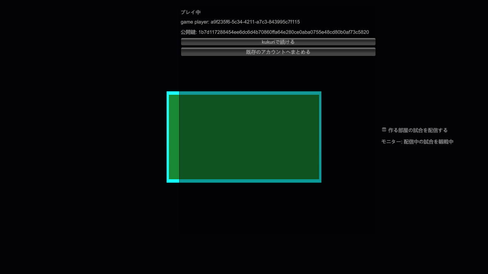
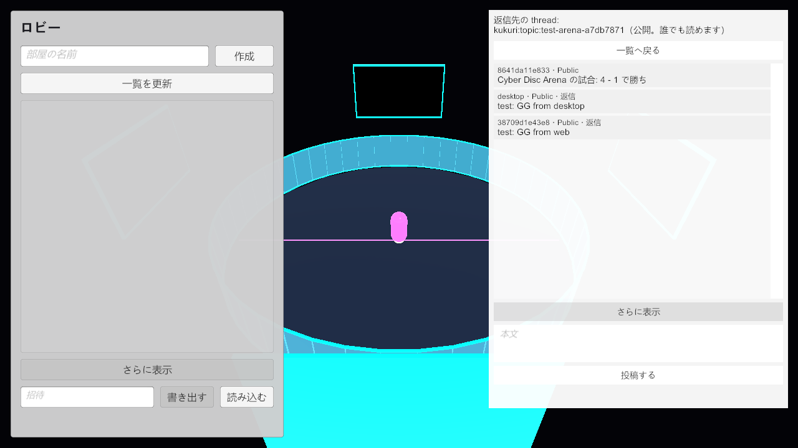

# #1984 AC-1: Game SDK の同時負荷の性能（ADR 0070 §8.4）と desktop・Web との相互運用

2026-11-03 に、ADR 0070 §8.4 の条件で全項目が 5 回とも合格した。計測した tree は、この記録を足した PR の head と同じ内容である（report の commit 欄は計測した作業 branch の commit で、まだ commit していなかった修正を含む）。

## 条件

- 機器: Ryzen 7 7800X3D / RTX 4080 SUPER / 64 GB / Windows 11 の 1 台。対戦者 2 人（1920×1080）と視聴者 5 人（1280×720、ArenaStreamViewer の scene）の 7 つの IL2CPP の Player、発行用の Sidecar、計測用の UDP proxy（`kukuri-sdk-net-proxy`）。
- network: 全 process の packet を proxy に通す。片道は packet ごとに 22.5〜27.5 ms、方向ごとに 1% を落とす。relay と DHT は使わない（Direct P2P だけ）。
- frame rate: 計測の Player は 1 秒に 120 frame まで（2026-11-03 のユーザー判断）。
- 時間と回数: 準備の後に 180 秒を 5 回。memory の増加は、同じ負荷を 600 秒続ける測定を別に 1 回。
- 手順: `sdk/unity/build-native.ps1` で native を置き、`examples/cyber-disc-arena-unity/slo.ps1 -Backend IL2CPP -Proxy <kukuri-sdk-net-proxy.exe>` を実行する。結果は `<ProjectDir>\runs\report.md` に出る。

## 結果

全 14 項目が PASS（[report](assets/1984/slo-il2cpp-report.md)）。主な値:

| 項目 | 値（5 回） | 閾値 |
| --- | --- | --- |
| frame time p95 / p99 | 8.4〜9.4 ms / 8.4〜9.6 ms | 16.7 ms / 25 ms |
| 入力の確定 p95（client） | 83.4 ms（各操作は 75〜83 ms） | 100 ms |
| 映像遅延 p95（直接 / 転送 1 段） | 98〜116 ms / 137〜181 ms | 500 ms / 800 ms |
| asset の反映（host / client） | 最大 5.4 s | p95 10 s |
| 適用中の frame time の最大 | 8.4〜12.6 ms | 33 ms |
| memory の増加（600 秒） | −3.8〜+1.5% | 5% |

Relay Supported P2P・Relay Fallback と家庭回線 2 拠点の値は測っていない（§8.4 で参考値。PASS / FAIL に数えない）。

## 計測で見つけて直したこと

| 症状 | 原因 | 直し方 |
| --- | --- | --- |
| asset の反映が 14〜31 秒 | 既定の Cubic は損失 1% で送る速さを落とす | QUIC の輻輳制御を kukuri 全体で BBR3 に（PR #2023） |
| asset の取得が 4〜9 秒でばらつく | proxy の遅延のゆらぎで packet の順序が入れ替わり、QUIC が損失と誤って送る速さを落とした | 損失とみなすまでの後の packet を 3 個から 64 個に（kukuri 全体、`kukuri-transport`） |
| 新しい release が読めず 2 秒後の読み直しまで遅れる | 読み先の候補（topic の参加者 4 人を順に回す）に新しい版を持つ peer が入らないことがある | 更新の hint を届けた peer を参加者より先に読む（`read_author_object` の `source`） |
| client の入力の確定が 85〜107 ms | host が受け止めを 30 Hz の tick でだけ確定していた | 届いていれば受け止めをすぐ確定し、tick を待たずに送る（`ArenaRules.Catch`） |
| 損失に当たった操作だけ 100〜150 ms | 操作と確定を確実に届く送り方で送り、損失で送り直しを待った | 操作を毎 tick の入力に、確定を毎 tick の状態に重ねて送る（Cyber Disc Arena） |
| 配信者の SDK の memory が 1 分に約 4 MiB 増える | ゲーム音と mic の非公開の broadcast の cache は、古い group を外す時計が進まなかった | 非公開の broadcast を配信の broadcast と同じ cache に置く |
| 配信者の SDK の memory が 1 時間に約 4 MiB 増える | moq-mux が区切りごとに足す timeline の記録を外していなかった（kukuri は読まない） | 映像の keyframe と音声の署名で外す |

memory の原因は、SDK の DLL を一時的に dhat の allocator で build し、配信の途中の 2 時点の確保の場所を比べて特定した。

## 計測の判断（ADR 0070 §8.4 に記録）

- 適用中の frame time は、取得を終えた更新の知らせを受けてからスキンを適用した frame までで判定する（2026-11-02）。
- 損失の判定の packet の数を 64 にする（2026-11-02）。
- 計測の Player を 120 frame/秒に抑える（2026-11-03）。上限が無いと client が 33 ms を超える frame を 180 秒に 11〜96 回出した。
- memory の増加は、1 分後からの sample の直線の傾きで判定する（2026-11-03）。映像の cache は入れ替わるたびに 2〜3 MiB 上下する。

## 見つけたが直していないこと

計測の準備で見つけた製品の性質で、この AC の受入条件の外にあるもの。

- topic に近隣ができる前に送った hint は届かない。購読の開始の読み直しは 1 回だけなので、近隣の無い購読者は、続いている Live や部屋を後から知らない。
- 取り込んだ peer は、すでに購読している topic にだけ join する。購読と取り込みの順で topic の overlay が分かれることがある。
- 多くの peer がいると、topic の join に最大 3 分ほどかかる（join のやり直しの間隔が 1〜64 秒）。
- `game_asset_updated` は、runtime が blob を取り終えてから出る（取り始めの知らせは無い）。

## desktop・Web との相互運用

2026-11-03 に、Cyber Disc Arena の Player の試験（`examples/cyber-disc-arena-unity/test.ps1`）に `-DesktopApp` と `-WebOrigin` を渡し、ゲームを入れていない desktop と Web を相手に、次をすべて確かめた（Mono と IL2CPP の両方）。desktop は main `ffdca6376` から配布と同じ release（custom-protocol）で build した。Web は CI の Web E2E と同じ試験用の build（`web-e2e-build`）を、画面の無い Chrome で開いた。

| 向き | 確かめたこと | desktop | Web |
| --- | --- | --- | --- |
| Unity → desktop・Web | 試合の Live の映像の frame を受け、開始 post へ応援する。host の ring の上に応援が出る（desktop は 👏 CLAP!、Web は 🎉 GG!） | ○ | ○ |
| Unity → desktop・Web | 試合の後に host が投稿した結果を、画像の添付つきで timeline から読む | ○ | ○ |
| desktop・Web → Unity | 同じ topic で camera の Live を始めると（WebCodecs の VP8）、観戦の Player のモニターがその配信を受けて映す（試験の camera の緑が、モニターの映像の中央の画素に出る） | ○ | ○ |
| desktop・Web → Unity | ゲームを終えた後に結果へ返信すると、再起動した host の掲示板で、結果の投稿の thread に同じ投稿 ID で並ぶ | ○ | ○ |
| 経路 | 観戦の Player が配信を見ている間の topic の経路（相手が 1 人以上、relay を通る相手は 0） | Direct P2P | Relay Supported P2P |

- 手順:
  1. 試験専用の Postgres と valkey を起動する。
  2. `cargo build -p kukuri-harness --bin web_e2e_fixture` で fixture を build する。
  3. fixture を `KUKURI_WEB_E2E_DIST=<dist-web>`、`COMMUNITY_NODE_DATABASE_URL`、`COMMUNITY_NODE_RENDEZVOUS_REDIS_URL` を与えて起動する。配信は 127.0.0.1:4180、Community Node は 127.0.0.1:4181。dist-web は Community Node を 127.0.0.1:4181 にした試験の build。
  4. `test.ps1 -WebOrigin http://127.0.0.1:4180 -DesktopApp <desktop の exe>` を実行する。Web の役は `C:\Program Files\Google\Chrome\Application\chrome.exe` の Chrome を使う。
- Web は ticket を使わず、fixture の Community Node でつながる。host と観戦の Player は、その Community Node の文書に同意する（再起動した host は保存した設定でつながる）。desktop は host・観戦の Player と ticket で直接つながる（host は 2 試合を終えると終了するので、試合の後の desktop の配信は観戦の Player へ直接届ける）。
- Web とつなぐ回は、Player を 127.0.0.1 に bind しない。WebRTC の ICE の候補は bind の IP から作られ、Chrome は loopback の候補と組まない。127.0.0.1 に bind した最初の回は、Web と Unity が Relay Fallback でつながった。既定の bind では既定の経路の IP が候補になり、Relay Supported P2P でつながった。
- 映像の到達は、desktop・Web の runtime の視聴の command（`next_live_video`）で判定した。画面への描画と音声は、既存の試験で確かめている。
  - Web の画面への描画と、Web と native の間の音声は #1879 の Web E2E。
  - Unity の texture への描画と音声は #1982。
- Unity どうしの対戦と、ゲームのスキンは、desktop・Web の相互運用の対象にしない。desktop・Web は action session の room を一覧に出さず（ADR 0070 §5.2）、ゲームの asset は Unity だけが使う。
- Web は Chrome だけで確かめた。Firefox・Safari では確かめていない。

### Community Node を使う構成でだけ不安定になる段（未解決）

試験の形を決めた後に desktop・Web を付けて 14 回（Mono 12・IL2CPP 2）回し、全項目が通ったのは 7 回（Mono 6・IL2CPP 1）だった。desktop・Web の段は、たどり着いた回ではすべて通った。落ちたのは #1983 から続く段で、Community Node と既定の bind を使うこの構成でだけ落ちた。

| 落ちた段 | 回数 |
| --- | --- |
| 観戦の Player のモニターが、2 試合目の配信へ移らない（1 回は別の試験の build と重なった回） | 4 |
| 再起動した host の最初の command（`import_peer_ticket` など）が 30 秒で時間切れになる | 3 |
| Player が交換の file（Player が書いた host・mini-host の ticket）を読むときの共有違反（`Sharing violation`） | 2 |

- 同じ head で desktop・Web を付けない従来の形（Community Node なし、127.0.0.1 に bind）は、3 回とも全項目が通った。
- 監査を受けて、経路（相手の数と relay を通る相手の数）とモニターの中央の画素の判定を足した後に、3 回回した。
  - desktop・Web の両方の IL2CPP と、desktop だけの Mono は、全項目が通った。
  - 両方の Mono は、Web の配信から desktop の配信へ移った直後に、モニターの映像の色が崩れていた（紫の block。中央の画素の判定で落ちた）。desktop だけの回と IL2CPP の回では、正しい緑だった。
- モニターが移らなかった回では、host が終えた Live を、観戦の Player の手元ではまだ Live として読んでいた（一覧と個別の読みの両方）。終わった配信を見直し続けるか、状態の知らせが来ないまま止まった。
- 原因は特定していない。
- 2026-11-03 のユーザー判断: この試験と記録は merge し、原因の調査と修正を AC-1 の残りとして続ける。直るまで AC-1 を完了にしない。
