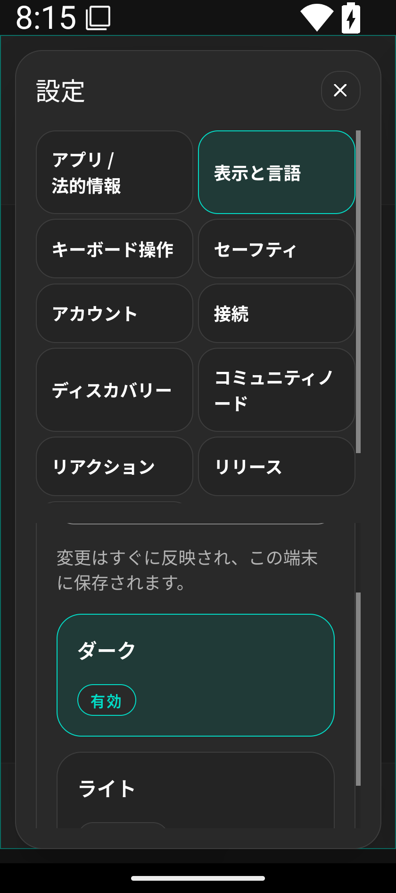
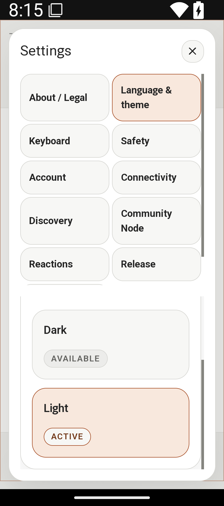
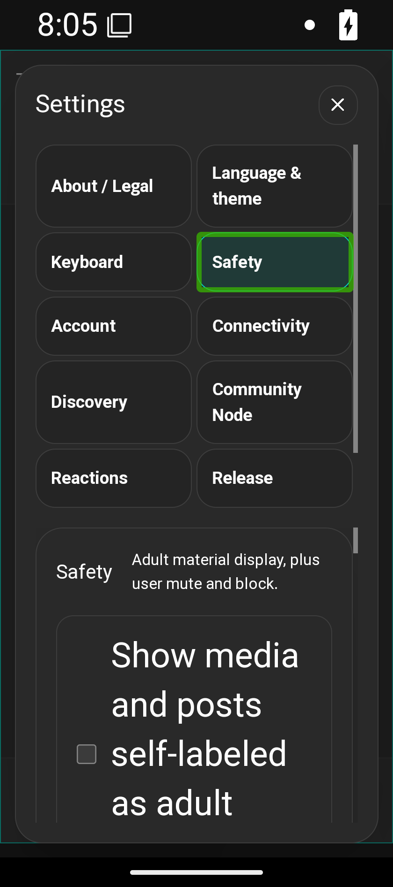
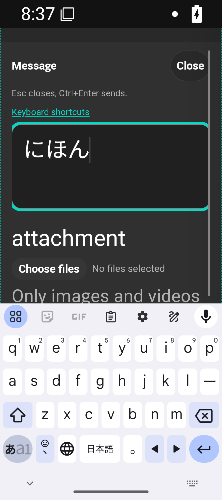
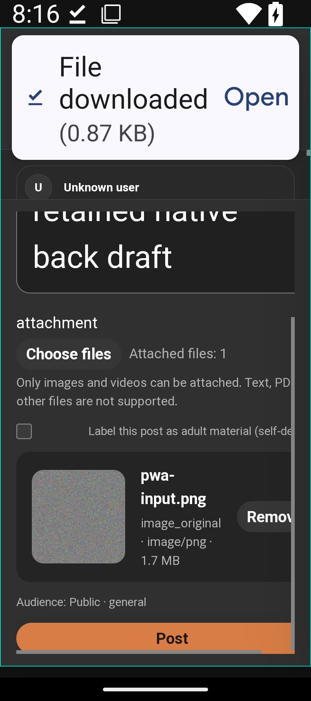
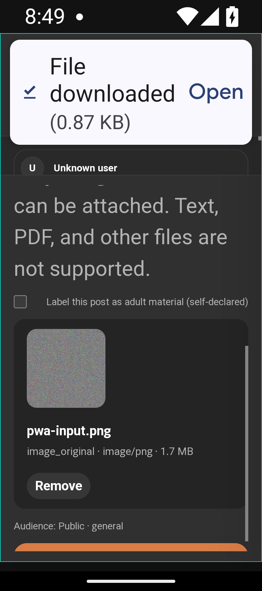

# 2026-10-12 Android PWA の入力と戻る操作

- Status: current
- Supersedes: None
- Superseded by: None
- PR: [#1771](https://github.com/kukuri-app/kukuri/pull/1771)
- Surface / user / purpose: Android Chrome のホーム画面から使う利用者が、入力中の本文と表示先を保持して、設定・dialog・composerを一層ずつ閉じられること。
- Summary: Web の dialog/composer/Control Center は共通の戻る層を使い、設定は既存 router の履歴を所有する。設定から別画面へ移る操作を閉鎖と区別する。狭い画面の添付行は折り返し、削除操作を幅内に保つ。
- Conditions: API35 Google APIs x86_64 / Pixel7 emulator、installed standalone PWA。Chrome124と通常Stable155.0.8059.39。320×720 CSS px・Android font_scale 2.0、縦横回転。初回同意/設定はJA/EN、既存dark/light。実機接続0回。
- Accessibility / interaction:
  - 実Gboard日本語QWERTYで投稿/返信/DMのcomposition開始→変換中Enter→composition終了を観測。Enter前後のID一覧は同じで、明示ボタン後に確定した「にほん」が保存される。[Chrome124固定00da](https://github.com/kukuri-app/kukuri/actions/runs/38172603098/job/114568405651)、[Chrome155固定579](https://github.com/kukuri-app/kukuri/actions/runs/38175162797/job/114576189631)。文字やcomposition eventの注入なし。
  - SDK TalkBack15を実際に有効化し、touch exploration有効を確認。実画面の探索でKeyboard/Safety/成人表示checkboxへ移る焦点と名前・矩形を、サービスを抑制しないinstrumentationで取得。[Chrome124](https://github.com/kukuri-app/kukuri/actions/runs/38170289417/job/114561616941)、[Chrome155](https://github.com/kukuri-app/kukuri/actions/runs/38172962642/job/114570924406)。試験終了時に解除。
  - keyboard→重なった画面→composerのBack、通常の設定閉鎖、ミュート一覧への移動、回転のscope/draft保持、招待/移行を貼付して確認前に取消、外部HTTP(S) URLからの帰還を実操作で確認。[Chrome124](https://github.com/kukuri-app/kukuri/actions/runs/38169233319/job/114558427599)、[Chrome155](https://github.com/kukuri-app/kukuri/actions/runs/38170396992/job/114561910197)。確認前の未加入/transfer idle/account不変も照合。
  - OS PhotoPicker/Filesの取消・read失敗・retry、診断downloadの実ファイルbytes一致を上記実測で確認。鍵は既存暗号化JSONの実clipboard copy/CtrlVで同公開鍵へ復元：[124](https://github.com/kukuri-app/kukuri/actions/runs/38163030689/job/114541423192)、[155](https://github.com/kukuri-app/kukuri/actions/runs/38164436503/job/114545437560)。
- Performance: history層は現在開いている画面だけを保持し、閉鎖時に削除する。CSS変更は表示中のcomposerだけに適用し、topic/accountの全件取得や再購読を追加しない。
- Validation: 実HashRouterを含むWebBack8/Routing13、型検査、変更file lint PASS。既存200% effective viewportの6 browser tests、file pickerのpointer/keyboard/長い名前/狭い画面の6 browser tests PASS。共通Back/settings/link/account/lifecycle/CSS差分の独立監査PASS・既知blocker0。修正後の実file操作と320px/200%のform横幅計測は[Chrome124](https://github.com/kukuri-app/kukuri/actions/runs/38172890769/job/114570647795)、[Chrome155](https://github.com/kukuri-app/kukuri/actions/runs/38174021784/job/114573797763)でPASS。最終固定headの全AC監査・実PR CIはPRの終了記録へ集約する。
- Not verified: Gboardの漢字辞書候補、TalkBackの音声録音/ADB swipe gestureは成果に含めない。installed124のlifecycleはPASSだが、freeze後のDirect P2P区間はrelay bytes混在で未確認。通信方式の既存契約を変更していない。
- Review result: 採用した戻る操作・実IME・設定のJA/EN両theme・添付行の到達性を確認。Chrome124/155の実操作はPASS。仮のビルド再利用設定と調査用診断表示を最終実装から撤去した。
- Exceptions: None。iPhone・停止中push・OS link/share・完全backup・新削除導線は承認済み初回対象外。

## 実画面

以下はemulatorから取得した未加工の画像。themeを反映して描画を待ってから保存した。

修正前の添付行は削除ボタンと補助文が横に切れる。固定AC内の到達性の不足としてCSSを修正し、同条件のChrome124で再確認した。内容と削除ボタンは横幅内へ折り返す。

