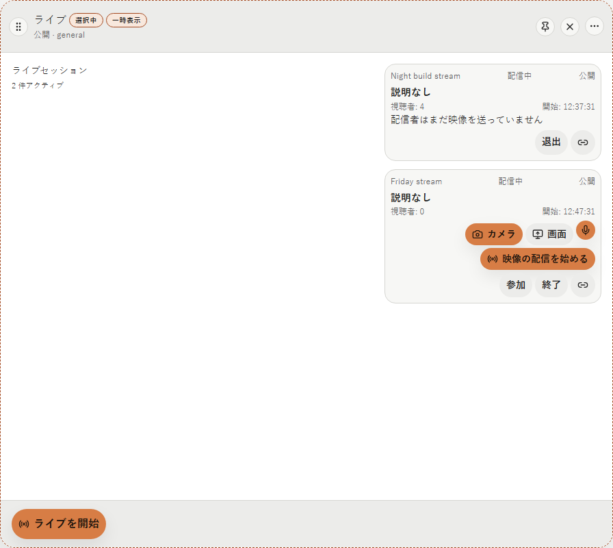
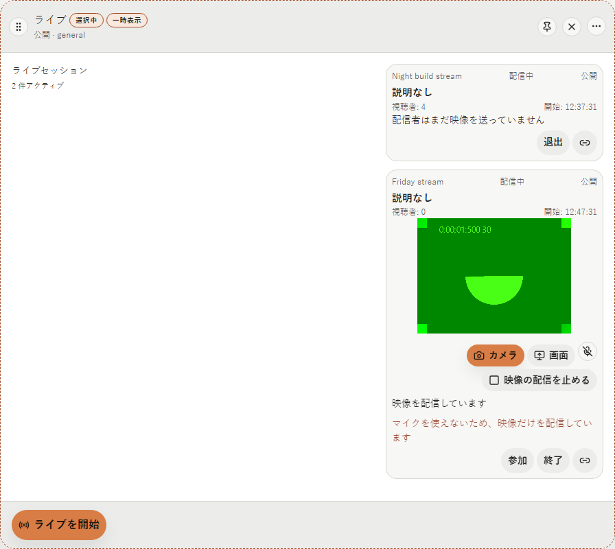
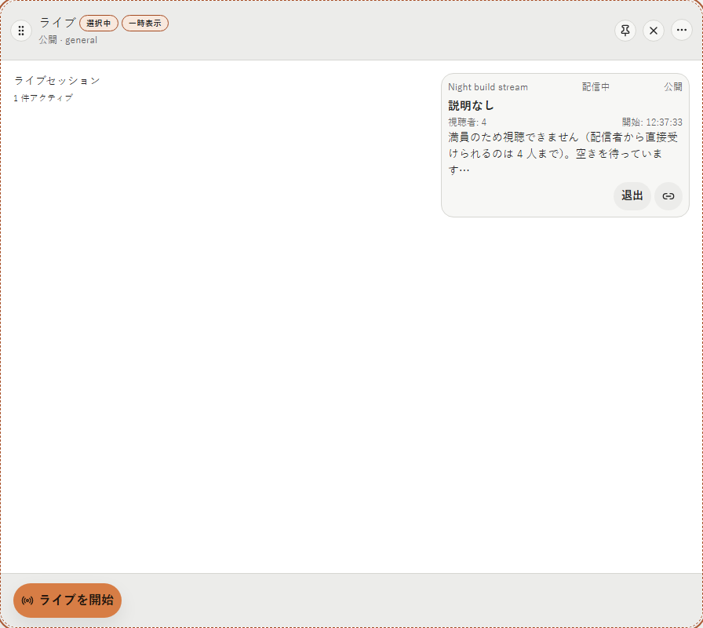
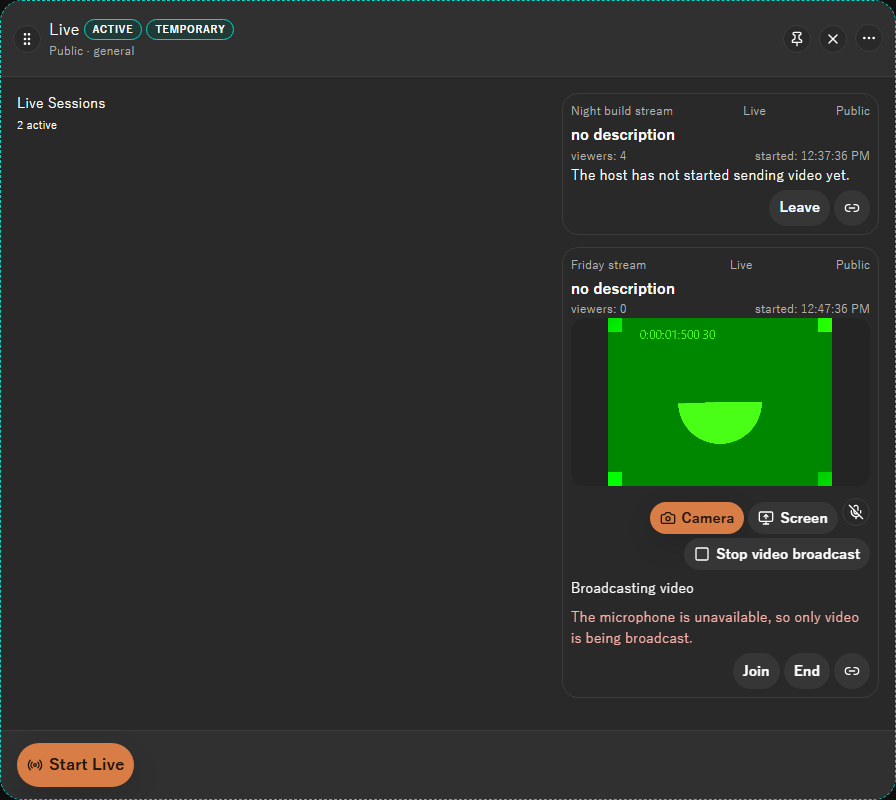

# 2026-10-13 live の映像の配信と視聴

- Status: current
- Supersedes: None
- Superseded by: None
- PR: #1034 AC-2a の PR（Refs #1034）
- Preview: 下の「画面」
- Surface / user / purpose: live の列の session の card。主催者が camera か画面と mic を配信し、参加した視聴者が映像と声を見聞きする。
- Summary: 主催者の配信中の card に、配信する映像（camera／画面）の選択・mic の on／off・映像の配信の開始／停止と、自分の映像の表示を置く。session の作成の Dialog は変えない。視聴者は「参加」で再生を始め、「退出」で止める。満員（配信者から直接受けられるのは 4 人まで）・映像がまだ無い・止まった状態を card の中に示し、5 秒ごとに試し直す。主催者が live の列を離れると配信は止まり、戻ったら card で始め直す。ADR 0067 D9〜D11（2026-10-13 のユーザー判断）。
- Conditions:
  - Platform: ブラウザ mock（Chromium 1.63 の Playwright、偽の camera）。Tauri の Windows（WebView2）と Linux（WebKitGTK）の実機は未確認。
  - Viewport: 1280×900（列の幅は既定）
  - Theme: light、dark
  - Locale: ja、en（zh-CN は文言だけ）
  - State: 配信前、配信中（mic を開けない）、視聴者の映像が無い、視聴者が満員
- Accessibility / interaction: 操作はすべて button で、名前を持つ。camera／画面は `role=group` の中の `aria-pressed`、mic は既存の HUD と同じ `aria-pressed` と mic のアイコン。状態は `role=status`、取り込みの失敗と mic を開けない旨は `role=alert`。自分の映像と配信の映像に名前を付けた。
- Performance: 取り込み・圧縮は encoder の待ち 2 frame、Rust への送りかけ 30 chunk、復号して描く前の frame 30、Rust から画面への送りかけ 30 chunk を上限にする（ADR 0067 §4）。session の一覧の読み込みは変えない。
- Validation: Vitest（`LiveSessionMedia.test.tsx`・`liveMedia.test.ts`、live を描く既存の画面の試験）、型検査・lint、Playwright の `extended-flow.spec.ts` に主催者の操作の表示を足した。
- Not verified: Tauri の実機（Windows・Linux）での camera・画面・mic・同期・途中参加・終了は、#1033 の実機確認と同じ機会に行う（手順は `docs/runbooks/live-media.md`）。
- Review result: 主催者と視聴者の各状態を ja・en と両 theme で確認した。
- Exceptions: None

## 画面

