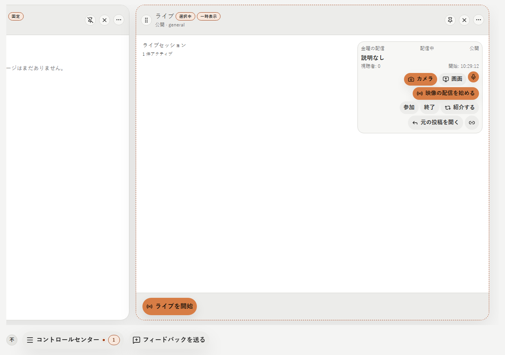
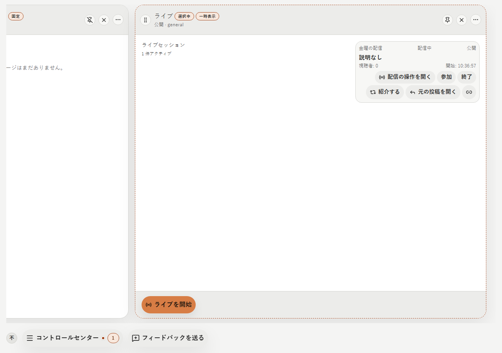
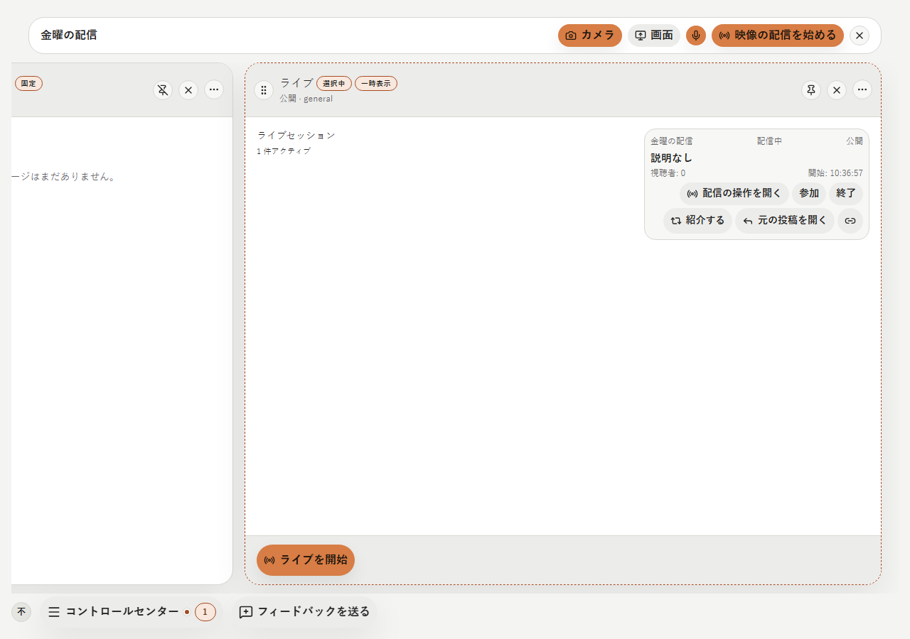
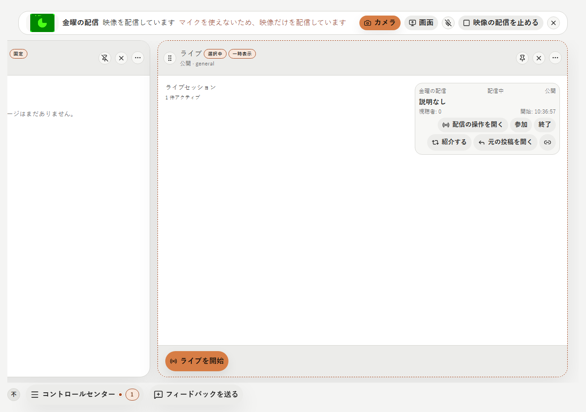
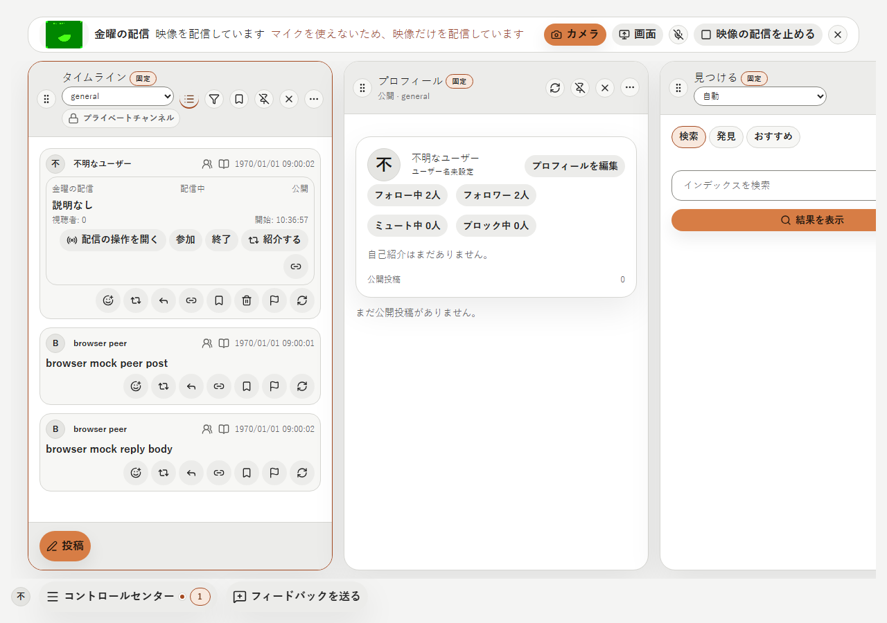
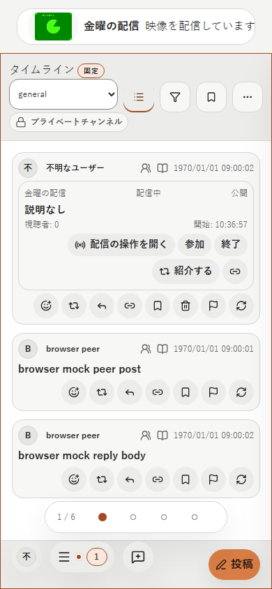
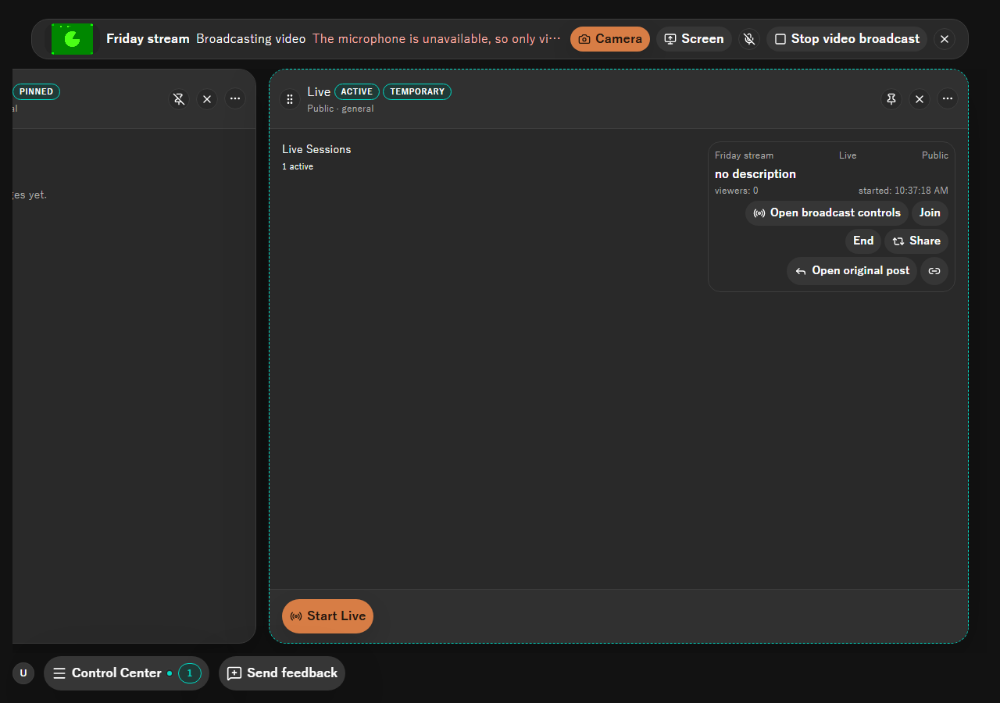
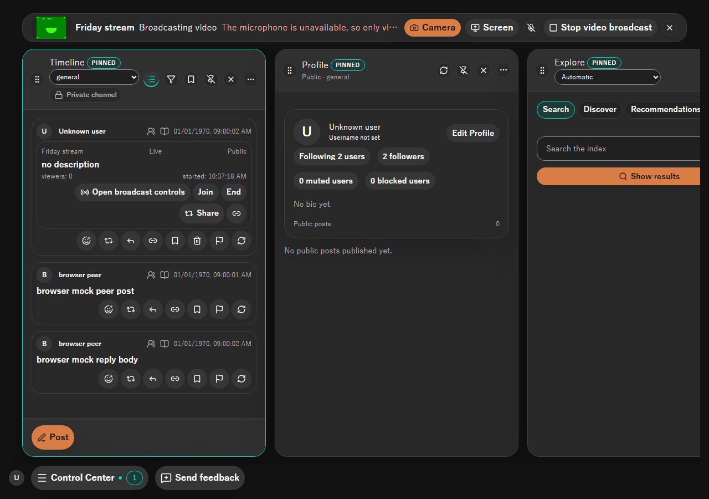

# 2026-10-17 shell の上部の配信の操作

- Status: current
- Supersedes: [2026-10-13 live の映像の配信と視聴](2026-10-13-1034-live-media.md) のうち、主催者の card の配信の操作と「live の列を離れると配信が止まる」の部分（視聴者の表示は変えない）
- Superseded by: None
- PR: #1839 AC-3 の PR（Refs #1839）
- Preview: 下の「画面」
- Surface / user / purpose: shell の上部の配信の操作の bar と、ライブの card（列・投稿の中）の主催者の操作。配信者が配信を始め、列や topic を移っても配信を続け、どこからでも止める。
- Summary:
  - 配信の操作（camera／画面・mic・開始・停止・自分の映像）を、主催者の card から shell の上部の bar へ移した。bar は「配信の操作を開く」で開き、閉じる・停止・ライブの終了で取り込みと送信を止める。
  - ライブの列を閉じる、別の画面・topic へ移る、投稿の card が画面外へ出ることでは配信を止めない（2026-10-17 のユーザー判断 6: 配信中の表示と停止は shell の上部に常に出す）。
  - この端末から同時に配信するのは 1 つのライブだけ。別のライブの bar が開いている間は、ほかのライブの「配信の操作を開く」を押せない。
  - bar を開いている間は、その高さを column の高さから差し引く（column の footer と Control Center を重ねない）。
- Conditions:
  - Platform: ブラウザ mock（Chromium の Playwright、偽の camera）。Tauri の実機は CI の実アプリの試験（Windows・Linux）で確かめる。
  - Viewport: 1280×900、390×844
  - Theme: light、dark
  - Locale: ja、en（zh-CN は文言だけ）
  - State: 主催者の card（変更前・変更後）、bar の開始前、配信中、ライブの列を離れた後、狭い幅
- Accessibility / interaction: bar は `section` に「<タイトル> の配信の操作」の名前を付けた。操作はすべて名前のある button で、camera／画面は `role=group` の `aria-pressed`、mic は `aria-pressed`、状態は `role=status`、失敗の理由は `role=alert`（変更前の card と同じ）。狭い幅では bar の中を横にスクロールして操作に届く。
- Performance: 取り込み・圧縮・送信の処理と上限は変えていない（ADR 0067 §4）。bar は配信の操作を開いている間だけ mount する。
- Validation:
  - Vitest: `LiveBroadcastBar.test.tsx`（変更前の card の試験を移した。取り込みの拒否で mic を開かず送信 0、別の端末の session、mic、閉じた後に届いた取り込みを止める、閉じる）、`DesktopShellPage.liveBroadcast.test.tsx`（列を離れても取り込みと送信が続き、bar の停止で止まり、ライブの終了で bar が閉じる）、`LiveSessionMedia.test.tsx`（視聴者だけ）。
  - Playwright: `extended-flow.spec.ts`（card から bar を開いて閉じる）。
  - 実アプリ: `live.mjs` の LV-11（配信中に配信者がライブの列を離れても、視聴者に描かれ音が出る）、LV-7（bar の停止で視聴者の描画と音が止まる）、LV-5（取り込みの拒否で配信が止まる）、LV-8（再起動の後に自動では始まらない）。CI の Windows・Linux の実アプリの試験で動く。
- Not verified: 手元では Tauri の実機を動かしていない（CI の実アプリの試験に任せる）。
- Review result: 配信前・配信中・列を離れた後・狭い幅を ja・light と en・dark で確認した。column は bar の高さだけ下がり、footer と Control Center は重ならない。
- Exceptions: None

## 画面

主催者の card（ja・light）:

bar（ja・light）:

bar（en・dark）:

