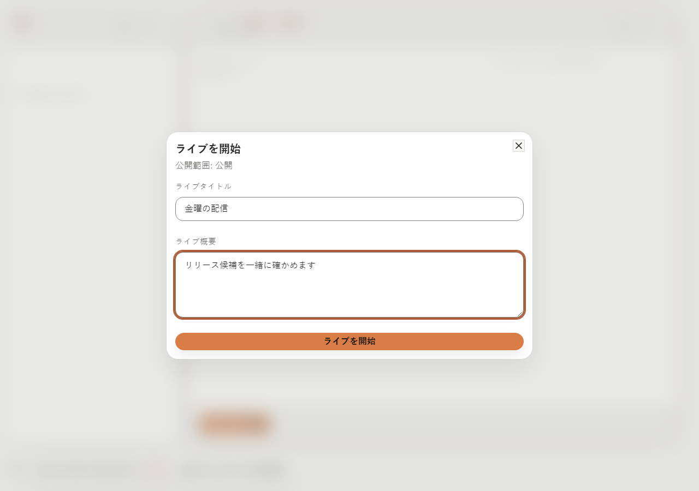
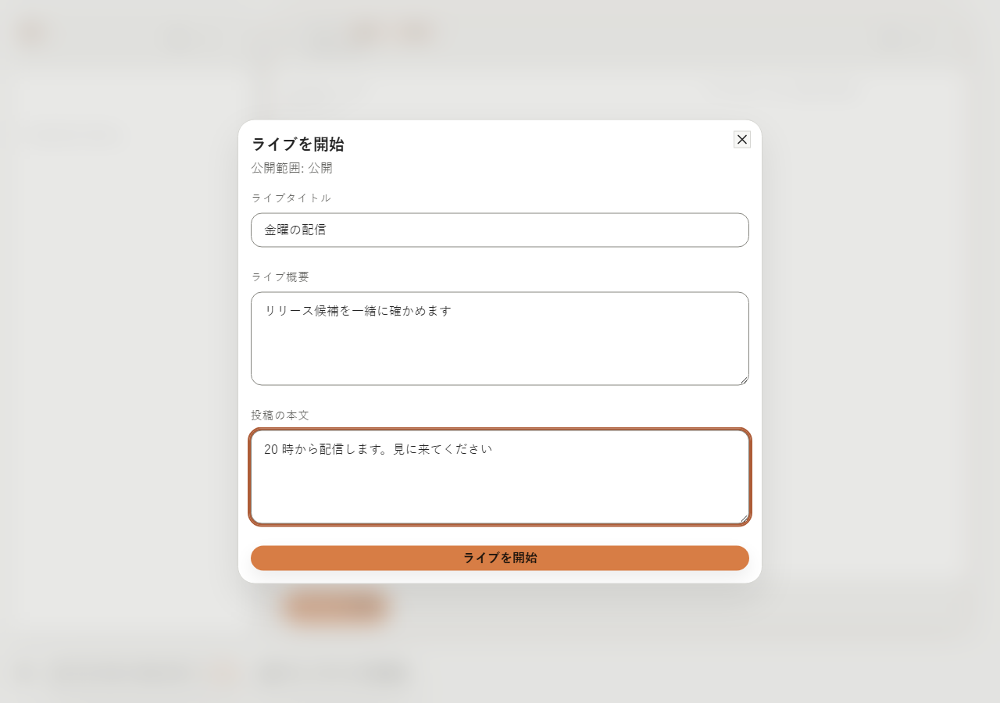
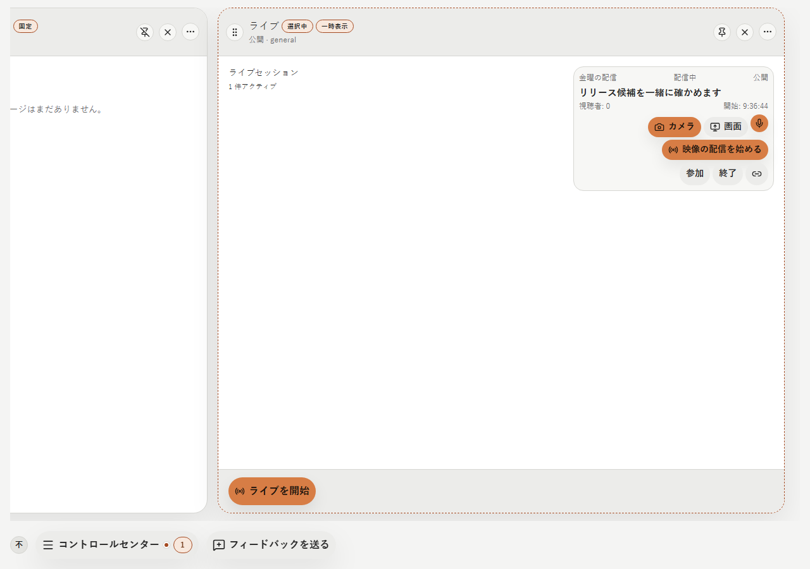
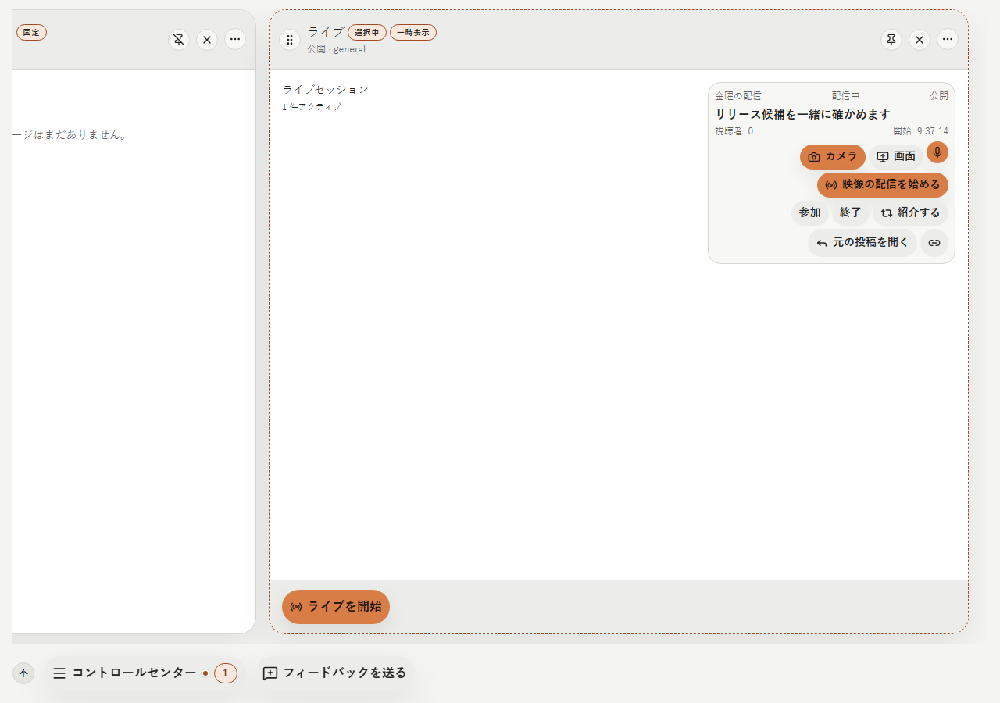
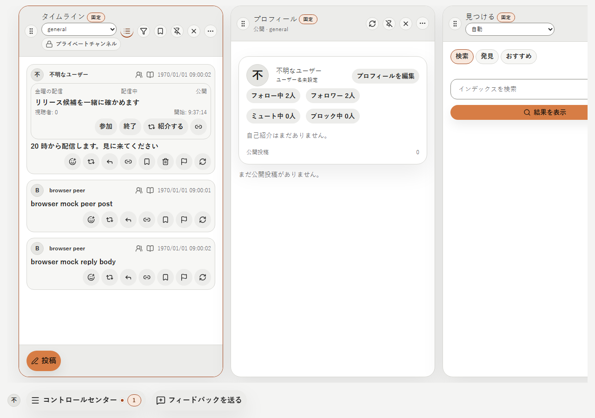
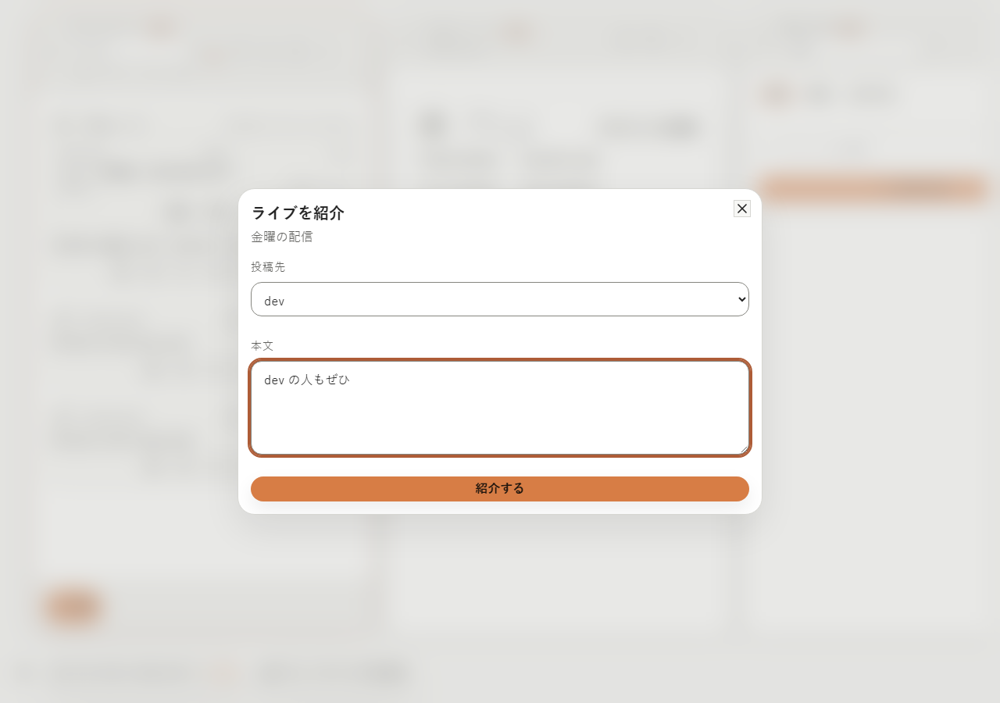
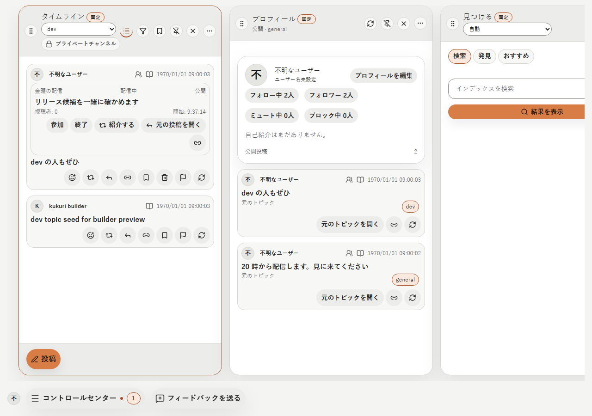
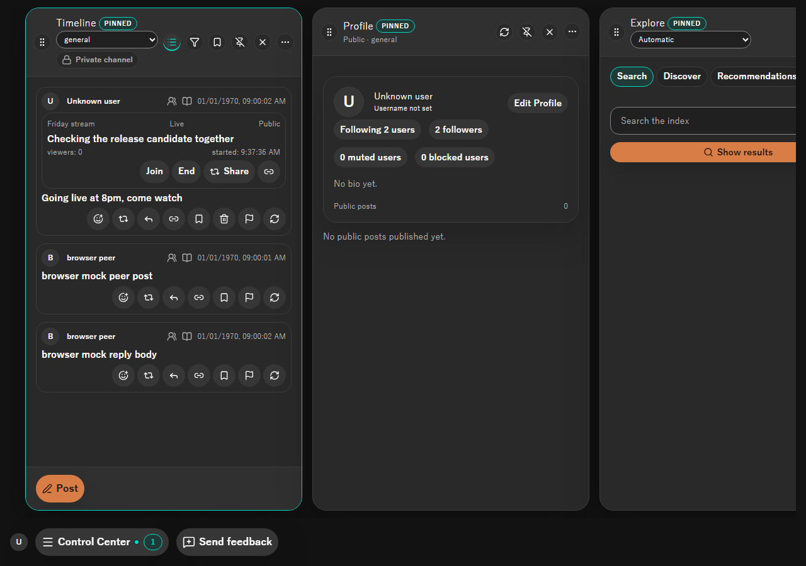
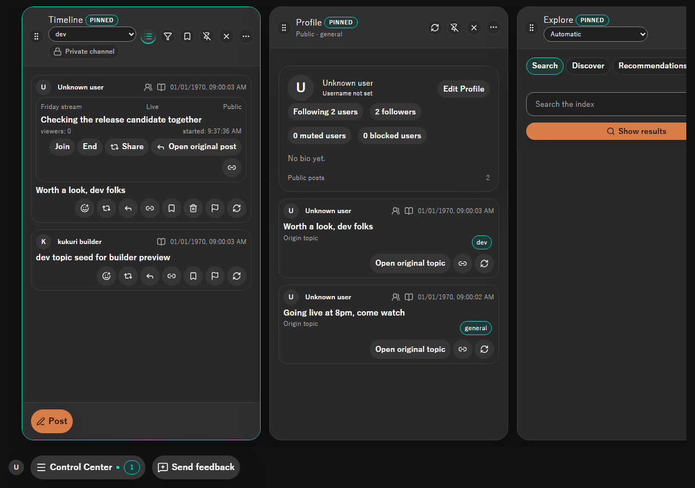

# 2026-10-17 投稿から始め・紹介する Live

- Status: current
- Supersedes: None
- Superseded by: None
- PR: #1839 AC-2 の PR（Refs #1839）
- Preview: 下の「画面」
- Surface / user / purpose: ライブの作成 Dialog、ライブの列の card、timeline の投稿の中のライブ、ライブを紹介する Dialog。配信者がライブを投稿と一緒に始め、配信者も第三者も別の topic・channel へ同じライブを紹介し、紹介を見た人が同じライブへ参加して元の投稿に返信・リアクションする。
- Summary:
  - ライブの作成 Dialog に「投稿の本文」を足した（空でもよい）。作るとライブの場所に元の投稿（開始 post）が出る。
  - ライブの列の card と投稿の中のライブを同じ card（`LiveCard`）で描き、「紹介する」と「元の投稿を開く」を足した。開始 post そのものの中では「元の投稿を開く」を出さない。
  - 「紹介する」は出し先を選ぶ Dialog を開く。出し先は追跡中の topic の公開の場所と参加中の channel。限定 channel のライブはその channel に固定する（2026-10-17 のユーザー判断 1・5）。
  - 投稿の中のライブは、画面に入ったときに元の topic と scope で表示を要求して読む。読み終えるまで「読み込み中」、読めなければ「このライブを読み込めません」。参照の channel とライブの channel が違うときも読めない扱いにする。
  - 映像の配信の操作はライブの列の card だけに出す。投稿の中の card が画面外へ出ても配信を止めないため（配信の操作の置き場所は AC-3 で shell の上部へ移す）。
- Conditions:
  - Platform: ブラウザ mock（Chromium の Playwright）。Tauri の実機は未確認。
  - Viewport: 1280×900（列の幅は既定）
  - Theme: light、dark
  - Locale: ja、en（zh-CN は文言だけ）
  - State: 作成 Dialog、ライブの列（配信者）、開始 post の中、紹介 Dialog、紹介 post の中。Storybook `Shell/PostLive` に開始 post・紹介 post・終了・限定 channel・読めないの各 state を置いた。
- Accessibility / interaction: 足した操作はすべて名前を持つ button。出し先は `<select>` に「投稿先」の label を付けた。Dialog は既存の Radix Dialog で、閉じると呼んだ場所へ focus を戻す。紹介の送信の失敗は Dialog の中に示し、出し先の timeline の投稿は既存の送信失敗と同じく再送できる。
- Performance: 投稿の中のライブは、画面に入った投稿の 1 件ずつを既存の表示要求で読み、手元の行を 1 件引く（主キー）。timer の読み直しはしない（projection の変化の通知で読み直す）。timeline の一覧の取得は変えない。
- Validation:
  - Vitest: `PostLive.test.tsx`（紹介 post から元の投稿・紹介 Dialog へ、読めない、channel の不一致、終了）、`DesktopShellPage.liveObject.test.tsx`（作成 → 開始 post の中のライブ → 別の topic を選んで紹介）。既存の画面の試験も通る。
  - Playwright: `extended-flow.spec.ts`（ライブの列の card に絞った）、`session-manifest-visibility.spec.ts`。
  - Rust: `crates/app-api/src/tests/live_object.rs` の `introduction_leads_to_the_same_live_and_its_start_post`（紹介 post から同じライブへ参加、開始 post への返信・リアクションと紹介 post 自身のリアクションが分かれる、同じ場所の 2 つのライブが独立）。
  - 型検査・lint。
- Not verified:
  - Tauri の実機（Windows・Linux）での表示と映像。AC-3・AC-4 の実機確認と同じ機会に行う。
  - プロフィールの列の投稿は、写しにライブの参照を持たないため、ライブを出さない（今回の利用場面の外）。
- Review result: 作成・開始 post・紹介・紹介 post を ja・light と en・dark で確認した。変更前と同じ条件でライブの列の card を比べ、増えたのは「紹介する」と「元の投稿を開く」だけであることを確かめた。
- Exceptions: None

## 画面

変更前と変更後（ja・light）:

変更後だけの面:

