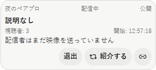
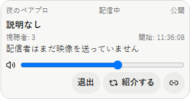
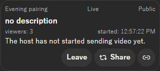
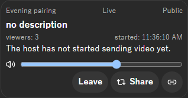

# 2026-10-17 Live ごとの音量

- Status: current
- Supersedes: None
- Superseded by: None
- PR: #1839 AC-4 の PR（Refs #1839）
- Preview: 下の「画面」
- Surface / user / purpose: 視聴者のライブの card（ライブの列・投稿の中）の映像の下。視聴者がライブごとに音量を変え、0 で無音にする。
- Summary:
  - 参加した視聴者の映像の下に、音量の slider（0〜100、`Volume2` のアイコン）を置いた。
  - 音量はライブごとにこの端末に保存し（最近変えた 64 件まで）、同じライブの別の表示も同じ値を示す。共有の状態には書かない（2026-10-17 のユーザー判断 4）。
  - 同じライブを 2 か所で表示しても、視聴（受信・音声の再生）は 1 つで、映像は両方に描く。
- Conditions:
  - Platform: ブラウザ mock（Chromium の Playwright）
  - Viewport: card の幅（列の既定の幅）
  - Theme: light、dark
  - Locale: ja、en（zh-CN は文言だけ）
  - State: 参加中の視聴者（映像がまだ無い状態。変更後は保存した音量 60%）。変更前は同じ条件で main を撮った。
- Accessibility / interaction: slider は native の `input type=range` に「音量」の名前を付け、keyboard の矢印で変えられる。アイコンは飾りで `aria-hidden`。
- Performance: 受信・音声の再生はライブごとに 1 つ。復号と描画は表示ごと（表示の数は画面に出ている card の数で有限）。
- Validation: Vitest（`LiveSessionMedia.test.tsx`: 2 つの表示で `watchLiveMedia` が 1 回・片方を閉じても続き最後で止まる、音量はライブごとで同じライブの表示が同じ値を示す・0 で無音の値を渡す、保存は 64 件まで）、runtime の `live_volume_is_kept_per_watched_session`、実アプリの LV-12（CI）。
- Not verified: 音が実際に 0 になることは実アプリの LV-12（Linux の音声）で確かめる。
- Review result: ja・light と en・dark で確認した。
- Exceptions: None

## 画面

視聴者の card（ja・light）:

視聴者の card（en・dark）:

