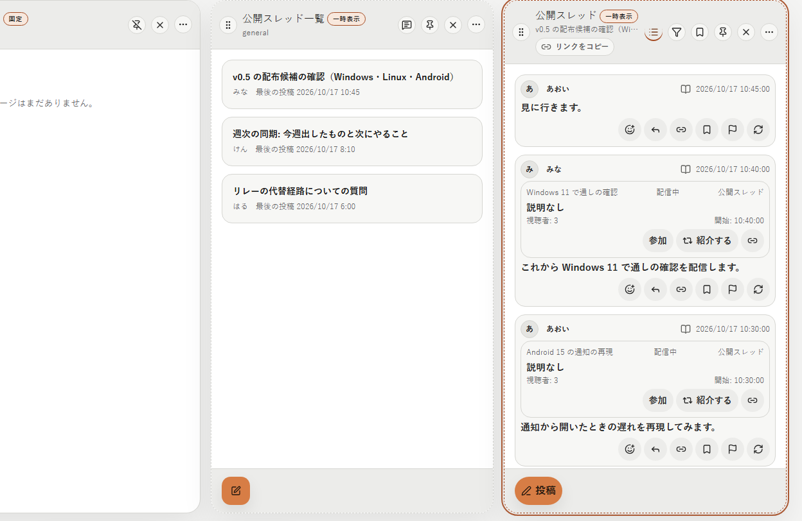
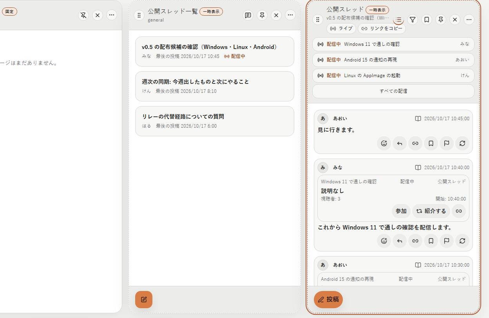
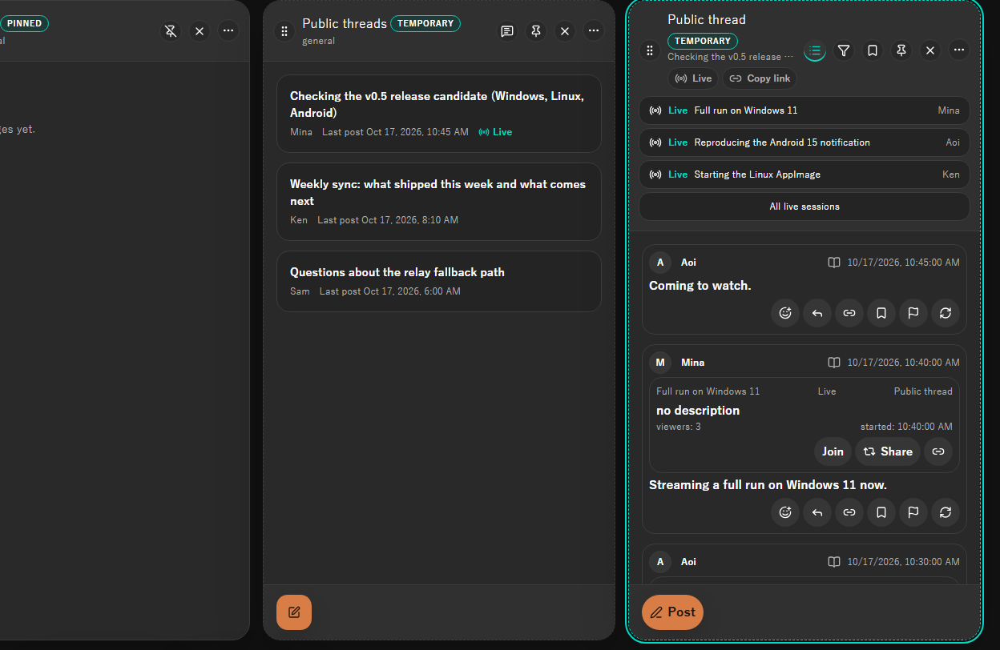
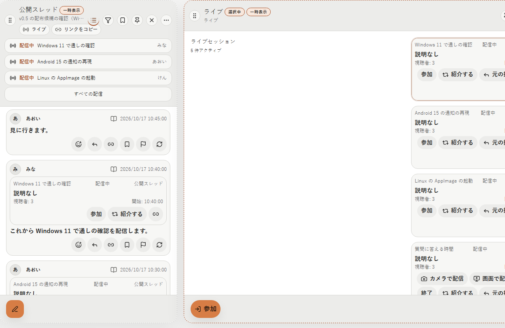
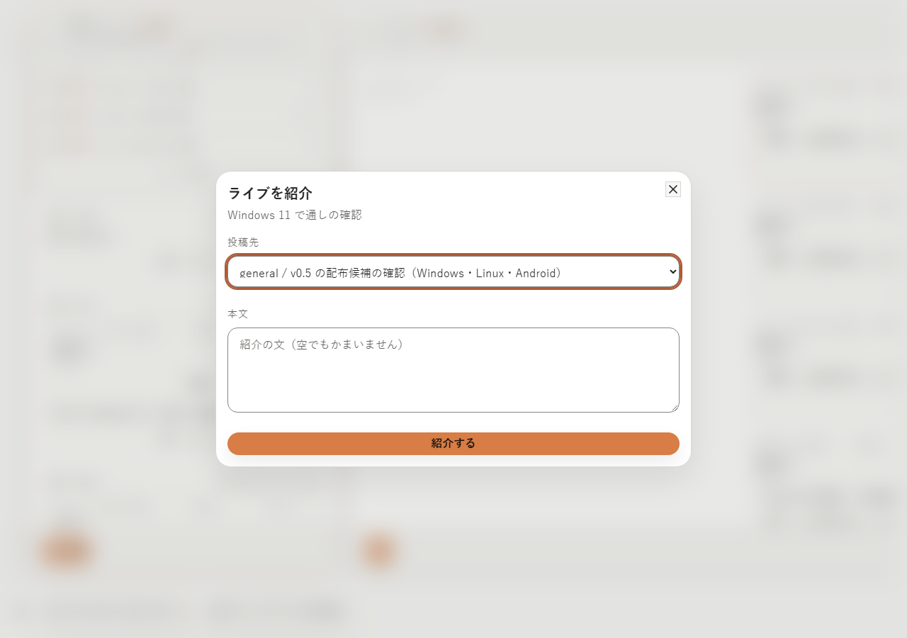
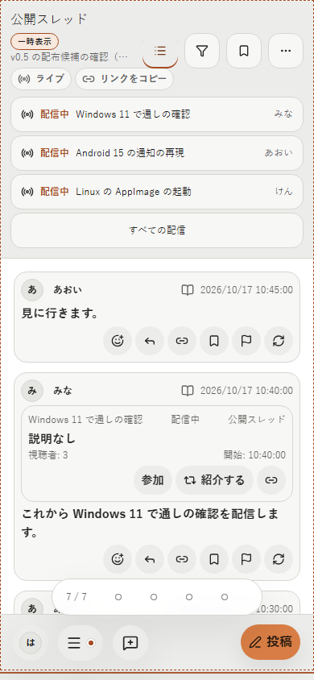

# 2026-10-18 公開スレッドの配信中の Live

- Status: superseded
- Supersedes: None
- Superseded by: [2026-10-25 ライブの開始・一覧・拡大表示](2026-10-25-live-entry-layout.md)
- PR: #1840 AC-4 の PR（Refs #1840）
- Preview: 下の「画面」
- Surface / user / purpose: 公開スレッドの詳細の列の上部、公開スレッドの一覧の列の行、スレッドの scope の「ライブ」の列、Live の紹介の Dialog。公開スレッドを見ている利用者が、そのスレッドで始まった配信を見失わずに視聴し、自分も同じスレッドで配信を始める。
- Summary:
  - 詳細の列の上部（本文と一緒に流れない header の下段）に、そのスレッドで始めた配信中の Live を、新しく始まった順に 3 件まで、タイトルと配信者の 1 行ずつで出す（2026-10-18 のユーザー判断 14。判断 6）。押すと、詳細の列を親にしたスレッドの「ライブ」の列が開いてその Live を示す。4 件以上は「すべての配信」から列を開く。
  - 上部の「ライブ」（「リンクをコピー」の隣。配信が無いときも出す）もスレッドの「ライブ」の列を開き、列の下部の「ライブを開始」でスレッドに Live を始める（判断 15）。開始 post はスレッドに入る。topic の「ライブ」の列には、スレッドの Live を出さない（判断 16）。
  - 一覧の行は、配信中の Live がある間、時刻の横に Live と同じ icon と「配信中」を出す（判断 2）。
  - スレッドで始めた Live の紹介の出し先は、始めたスレッドを先頭（既定）にし、ほかは公開の Live と同じ（判断 17）。紹介 post を足しても、上部の行は Live ごとに 1 件のまま。
  - 上部の行・「ライブ」・一覧の印は、既存の Live の画面と同じく開発者モードでだけ出す（README の Experimental）。Web は Live を扱わない（ADR 0060）ので出さない。
  - 非表示の主催者（mute・block、CN の評価で非表示を勧めるもの）の Live は上部に出さない（CN の評価で畳んだ Live は「ライブ」の列で確かめて表示できる）。配信者の名前は手元の作者の情報から出し、上部に出す主催者は game の一覧の主催者と同じ取得で読む。自分の Live は自分の profile の名前。
- Conditions:
  - Platform: ブラウザ mock（Chromium の Playwright）。Tauri の実機は、この変更が WebView の固有の機能を使わない（映像の受信と送信は #1839 のまま）ので対象外。
  - Viewport: 1280×900、390×844
  - Theme: light、dark
  - Locale: ja、en（zh-CN は文言だけ。i18n の一致の試験で鍵を確かめた）
  - State: 詳細の上部（配信中 4 件と終了 1 件のスレッド。3 件と「すべての配信」）、一覧の行の印、上部の行から開いた「ライブ」の列、紹介の Dialog、狭い幅の詳細。配信中 2 件・0 件、印あり・なし、開発者モードの無効は Storybook（`Shell/PublicThreads`）と Vitest で確かめた。変更前は main（`8c401846f`）を同じ初期データで撮った。
- Accessibility / interaction:
  - 上部の行は名前のある button（例: 「配信中 Windows 11 で通しの確認 みな」。文言の間に空白を入れて読み上げの名前を区切った）。「すべての配信」と「ライブ」も button。
  - 上部は header の中にあり、本文を流しても見える位置に残る（Playwright で、開始 post を本文の外へ流した後に行が画面内にあり、押して「ライブ」の列が開くことを確かめた）。
  - 狭い幅では行の高さを 44px にした（DESIGN の touch の目標）。
- Performance: 上部は、表示中の詳細の列だけがスレッドの `list_live_sessions`（上限 100 件）を読む。読むのは列が active になったときと同期の時刻が変わったときで、timer では読み直さない（「ライブ」の列と同じ）。配信者の名前を読むのは、列ごとに上部に出す 3 件の主催者だけ。一覧の行の印は、一覧の取得が行ごとに配信中の行だけの部分索引から 8 件まで読んで付ける（終わった Live の数に比例しない。query plan の試験で索引を使うことを確かめた）。上部と印を出すだけでは、映像・音声を受信も送信もしない。
- Validation:
  - Vitest: `DesktopShellPage.publicThreadLives.test.tsx`（上部の「ライブ」から詳細を親にした列を開いてスレッドに Live を始める → 上部に行が出て開始 post がスレッドに入る → 紹介の出し先の先頭がスレッドで、紹介しても行は 1 件 → 行から列でその Live を示す → 終えると上部から消え、開始 post は残る。一覧の行に印が出る）、`PublicThreadLive.test.tsx`（新しい 3 件と「すべての配信」、終了・CN の評価・mute の主催者を出さない、配信が無ければ出さない、一覧の印と「ライブ」は開発者モードでだけ出す）、既存の公開スレッド・Live・channel の試験。
  - Playwright: `public-thread-lives.spec.ts`（作成 → 「ライブ」→ 列で開始 → 上部の行 → 投稿を重ねて開始 post を本文の外へ流しても行が画面内にあり、押すと列がその Live を示す）、既存の `public-threads.spec.ts` ほか。
  - Storybook: `Shell/PublicThreads` の `ListLiveMark`・`ThreadLives`・`ThreadLivesMore`。
  - app-api: `lives_started_in_a_public_thread_are_listed_and_marked_until_the_last_one_ends`・`a_thread_live_is_watched_with_the_topic_access_and_hidden_hosts_are_not_marked`。store: 配信中の行の一覧の query plan の試験と migration の試験。
- Not verified: Tauri の実機（WebView の固有の機能を使わないので対象外）。zh-CN の画面の撮影（文言だけ確かめた）。
- Review result: 詳細の上部・一覧の印・「ライブ」の列・紹介の Dialog・狭い幅を ja・light と en・dark で確認した。最初は行を見出しの欄の中に置いたため、header の右の操作に幅を取られて行がはみ出し、操作と重なった。行は header の下段に幅いっぱいで置く形に直した（下段を持つ header だけ折り返す）。配信者の名前が出なかった（Live の主催者の名前を読んでいなかった）ので、上部に出す主催者の名前を読むようにした。
- Exceptions: None

## 画面

詳細の列の上部と一覧の行の印（ja・light。変更前と変更後）:

en・dark:

上部の行から開いたスレッドの「ライブ」の列（ja・light）:

紹介の Dialog（ja・light。出し先の先頭が始めたスレッド）:

狭い幅の詳細（ja・light、390×844）:

