# 2026-10-18 公開スレッドの一覧・詳細・本文のリンク

- Status: current
- Supersedes: None
- Superseded by: None
- PR: #1840 AC-3 の PR（Refs #1840）
- Preview: 下の「画面」
- Surface / user / purpose: topic の公開スレッドの一覧の列、作成の Dialog、詳細の列（scope が公開スレッドのタイムラインの列）、本文の中の公開スレッドのリンク、Control Center の topic の行。topic を見ている利用者が、その中のタイトル付きの公開の会話を見つけて開き、同じスレッドへ投稿・返信する。
- Summary:
  - Control Center の topic の「公開」の次に「公開スレッド」の行を置き、列の追加の一覧にも「公開スレッド一覧」を置く（2026-10-17 のユーザー判断 9）。どちらもその topic の一覧の列を開く。
  - 一覧の行はタイトル・作成者・並び順の時刻。並び順（最後の投稿の新しい順・作成の新しい順）は列の上部の icon の menu で切り替え、列と一緒に保存する。0 件は作り方の案内と「スレッドを作る」を出す。読めないスレッドの数・続き・最新に戻る・失敗の表示はタイムラインと同じ形。
  - 作成は列の下部の「スレッドを作る」の Dialog（タイトルと最初の投稿）。作った後は詳細の列を開く。
  - 詳細の列の見出しは「公開スレッド」（Control Center の列の一覧でも同じ）、scope の表示は「<タイトル> · <topic>」。上部の「リンクをコピー」でスレッドのリンクを写す。タイトルを読めなければ「タイトルを取得できません」と出す。新しく開く詳細の列は、その topic の一覧の列を親にする（直接リンクや本文のリンクから開いても、閉じると一覧へ戻る）。
  - 本文の中のリンクはどれもタイトルの chip になる（知らないスレッドは、画面内にある間に読む）。本文の下に最初の 1 件だけ、タイトルと作成時の最初の投稿の card を出す（判断 10）。card の見た目は外部のリンクの preview と同じ。
  - 非表示の作者（mute と、どちらの向きの block）のスレッドは、一覧の行・本文の chip と card・詳細の見出しに出さない（INVAR-2。一覧と ID からの取得が除くのと同じ）。
  - 公開スレッドの投稿の公開範囲の icon は公開と同じ `book-open` で、tooltip は「公開スレッド: <タイトル>」（判断 11）。
  - 列の見出しと状態の印（一時表示・固定）が 1 行に収まらないときは、印を次の行へ送る。詳細の列は上部の操作が多く、英語の「Public thread」が省略されていたため。既存の列で 1 行に収まっていたものは変わらない（en・dark の一時表示のタイムラインの列の上部を変更の前後で撮り、PNG の SHA-256 が一致した）。印が狭い幅で 2 行に割れていたのも直した。
- Conditions:
  - Platform: ブラウザ mock（Chromium の Playwright）。Tauri の実機は、この変更が WebView の固有の機能を使わないので対象外。
  - Viewport: 1280×900、390×844
  - Theme: light、dark
  - Locale: ja、en（zh-CN は文言だけ。i18n の一致の試験で鍵と置き換えの変数を確かめた）
  - State: 一覧（行あり・0 件・並び順の menu）、作成の Dialog（入力中）、詳細（投稿あり・公開範囲の tooltip・タイトルを取得できない）、本文のリンクの card（タイトルと最初の投稿）、狭い幅の一覧と詳細。読み込み中・失敗・読めない数・続きあり・card のタイトルだけと取得できないは Storybook（`Shell/PublicThreads`）と Vitest で確かめた。
- Accessibility / interaction:
  - 一覧の行・本文の card は名前のある button で、文言の間に空白を入れて読み上げの名前を区切った（例: 「公開スレッド v0.5 の… 配布候補を…」）。
  - 並び順の menu は `role=menu` と `menuitemradio`（`aria-checked`）で、keyboard の Enter で開き、上下の key で移り、Enter で選ぶ（タイムラインのフィルターと同じ部品。Vitest と Playwright で keyboard だけで選んだ）。trigger の名前は「並び順: <今の並び>」。
  - 作成の Dialog は title と説明を持ち、タイトルが空の間は「作る」を押せない。Escape で閉じる。
  - 狭い幅では、列を閉じる操作は列の menu の中にある（既存の列と同じ）。
- Performance: 一覧は表示中の列だけが 3 秒ごとに先頭のページ（20 件）を読み直し、行は 200 件までにする（タイムラインと同じ）。1 回の読み直しの量と表示する行の数に上限があり、topic のスレッドの総数に比例しないので、長い一覧の計測はしていない（topic の総数に対する読み出しの量は AC-2 の試験 `a_list_page_reads_the_same_amount_however_many_unrelated_threads_and_posts_exist` で確かめた）。覚えたスレッドは 256 件までで、内容が変わったときだけ store を変える。列の見出しと Control Center は列の scope のタイトルだけを購読し、タイトルを知ったときだけ描き直す。本文の chip と card は画面内にある間だけ ID から読み、読み込みは画面で共用する（同じスレッドを並行して読まず、読めたものは使い回す）。読めた値は chip と card が持つので、画面内のリンクが覚える上限より多くても、読み込みは 1 件につき 1 回で止まる（上限より 44 件多いリンクを応答の時間をばらつかせて置き、試験で確かめた）。作成者の名前は、ページの作成者の手元の profile から付け、無い profile はタイムラインの投稿と同じ背景の取得（重複を除き、間隔と上限つき）へ渡す。
- Validation:
  - Vitest: `DesktopShellPage.publicThreads.test.tsx`（Control Center の行から一覧 → 作成 → 詳細が一覧の列を親にして開き投稿できる → 公開スレッドの中で返信できる → topic のタイムラインに出ない → 閉じると一覧へ戻る。並び順を keyboard で選び、pin し、再起動の後に並び順と pin が戻る。本文の 2 つのリンクがどちらもタイトルの chip になり、最初の 1 件の card から開いて一覧へ戻る。直接リンクで一覧の列も開き、リンクをコピーし、再起動の後に戻り、閉じると一覧へ戻る）、`PublicThreadList.test.tsx`（mute した作者のスレッドを、読み込んだ行・chip・card・列の見出しにすぐ出さない）、`PublicThreadProviders.test.tsx`（ID からの読み込みの共用、store から外れた後のタイトル、覚える上限より多いリンクでも 1 件につき 1 回だけ読む、読めないスレッドの表示と読み直し）、`publicThreadListState.test.ts`（先頭のページの重ね方・200 件の上限・覚えたスレッドの上限）、`internalLinks.test.ts`（公開スレッドのリンクの解析と最初の 1 件）、`columnScopeLeases.test.tsx`（一覧の列は topic の scope、詳細の列は公開スレッドの scope）、`presentation.test.ts`（公開範囲の名前）、既存の route の同期・列の scope・タイムラインの表示の試験。
  - Playwright: `public-threads.spec.ts`（作成 → 投稿 → 戻る操作で一覧 → 行から開く → リンクのコピーを topic のタイムラインに貼ると card が出る → card から開いて閉じると一覧 → 並び順を keyboard だけで選ぶ。狭い幅で詳細を閉じると一覧）、`column-scope.spec.ts`。
  - Storybook: `Shell/PublicThreads`（一覧の行・作成の新しい順・読み込み中・0 件・失敗、card のタイトルと最初の投稿・タイトルだけ・読み込み中・取得できない、作成の Dialog）。
  - app-api: `public_channel_rows_carry_the_creator_profile_names`（作成者の名前が付き、手元に無い profile は背景で読まれて次の取得で付く）、`hidden_creators_threads_are_left_out_of_the_list`（mute した作者のスレッドを、一覧に加えて ID からも返さない）と既存の公開スレッドの試験。
- Not verified: Tauri の実機（WebView の固有の機能を使わないので対象外）。zh-CN の画面の撮影（文言だけ確かめた）。
- Review result: 一覧・作成・詳細・本文の card・狭い幅を ja・light と en・dark で確認した。Control Center の列の追加のボタンでは、日本語の「公開スレッド一覧」がボタンの中で 2 行に折り返す（視覚回帰の基準画像 `control-center-ja-dark.png` を作り直した）。並び順の menu は日本語の「最後の投稿の新しい順」が収まらず icon が縮んでいたので、menu の幅を広げた。詳細の列の見出しの省略と、状態の印の割れを直した。
- Exceptions: None

## 画面

Control Center の topic の行（ja・light）:

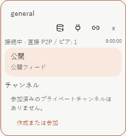
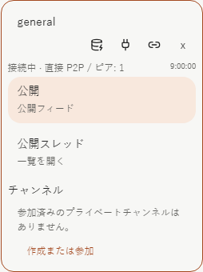

一覧の列（ja・light）:

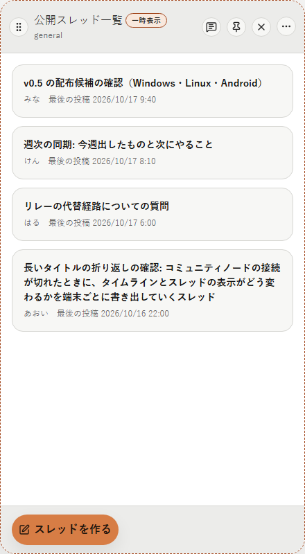
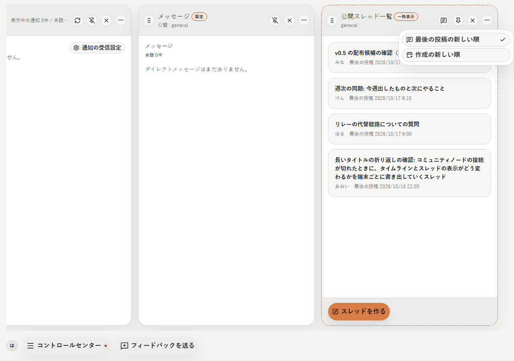
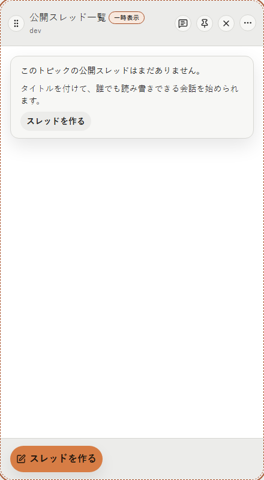
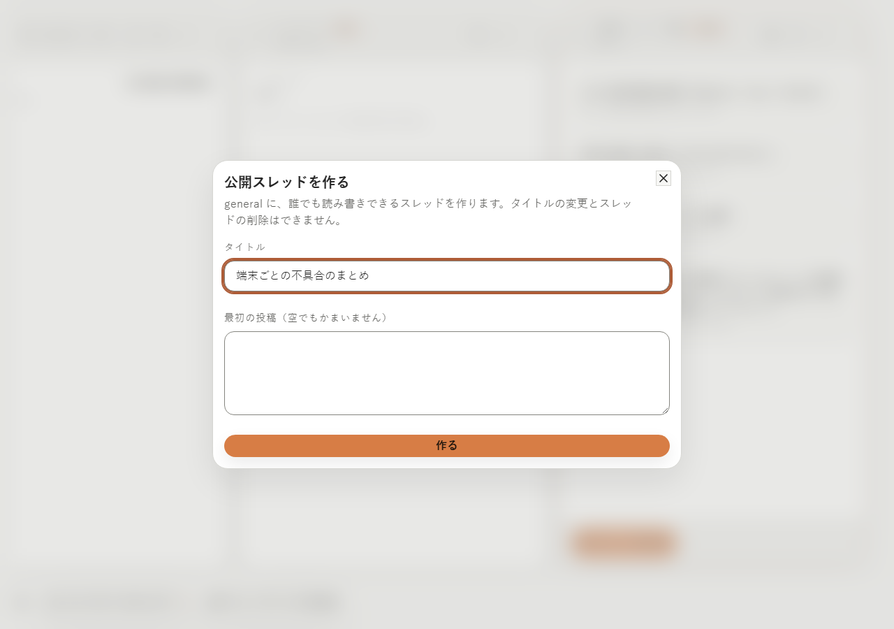

詳細の列（ja・light）:

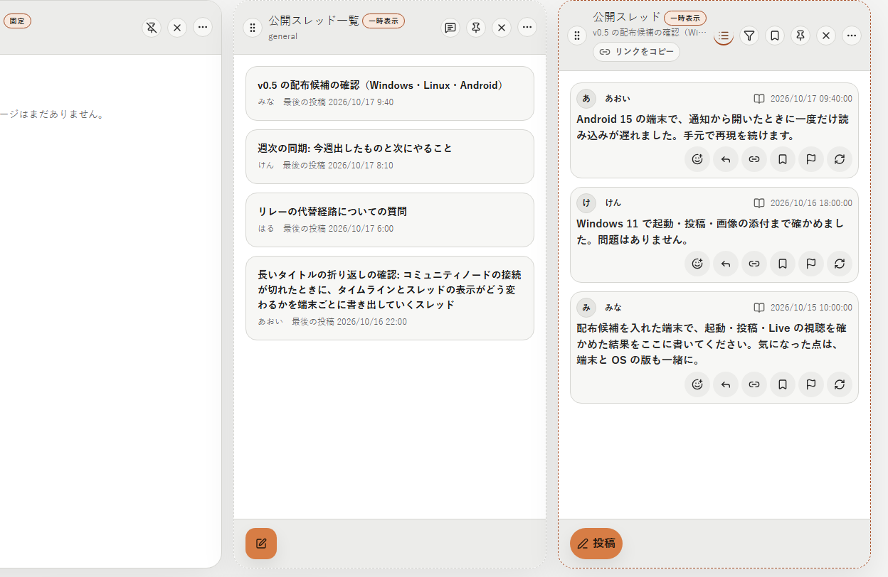
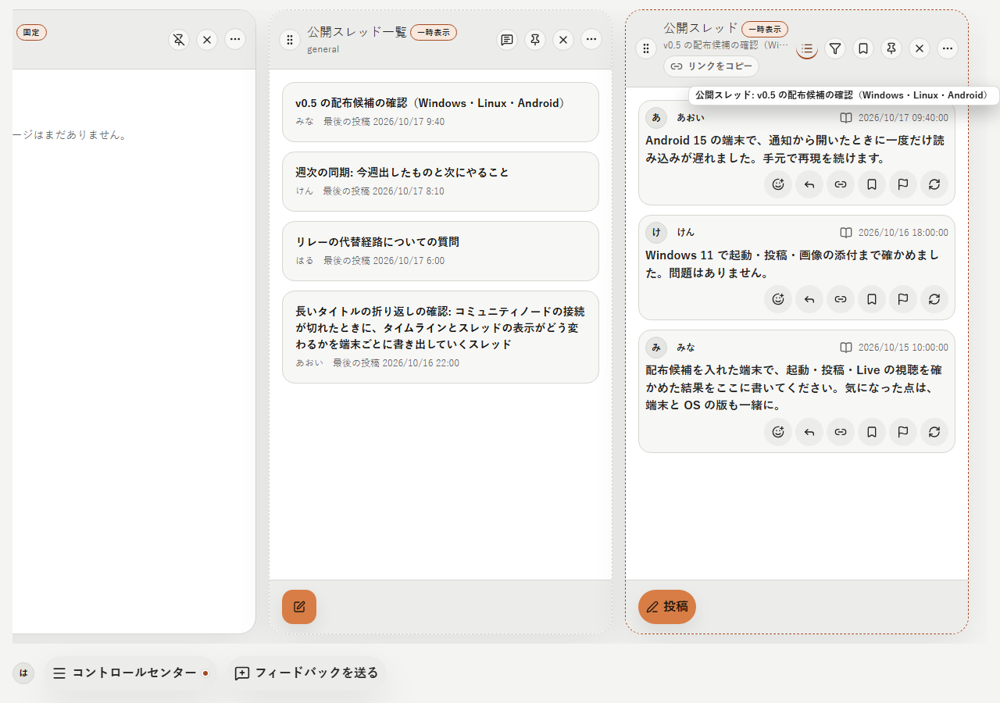
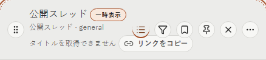

本文の中のリンク（ja・light）:

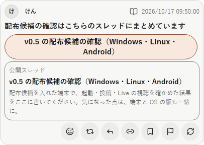

狭い幅（ja・light、390×844）:

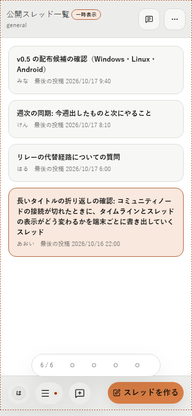
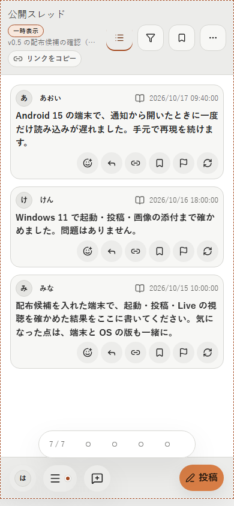

en・dark:

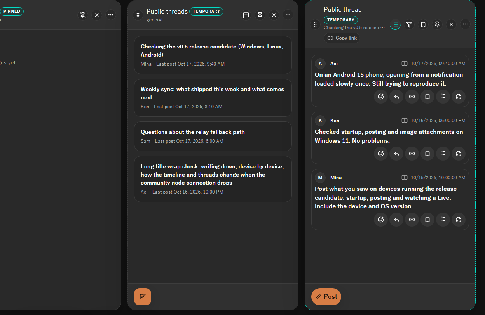
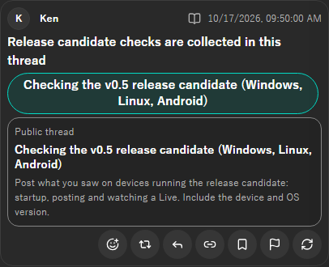
