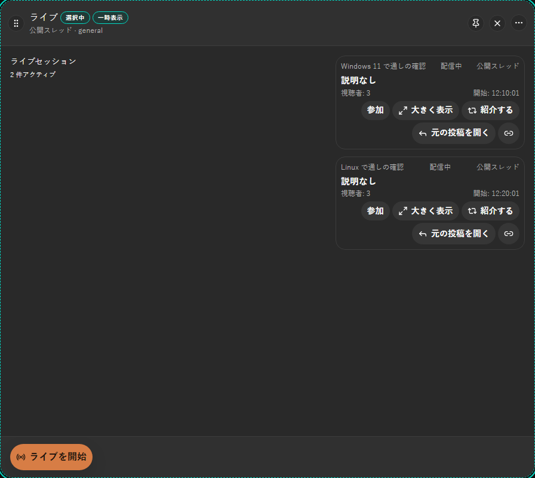
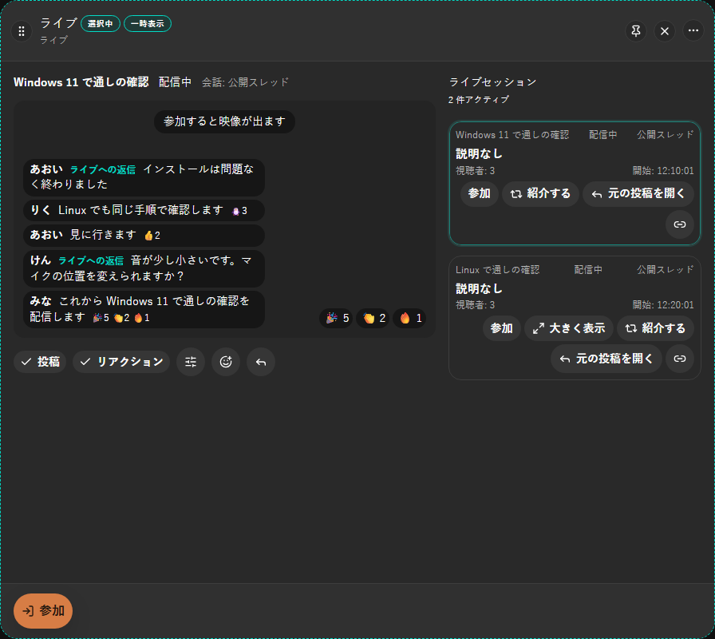
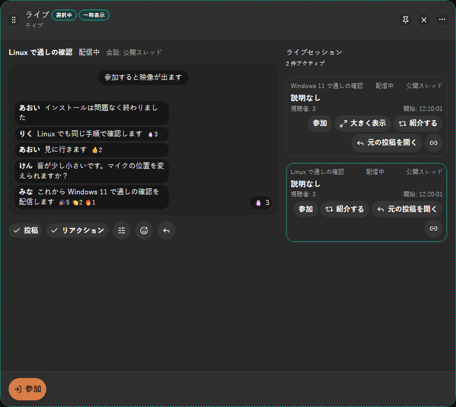
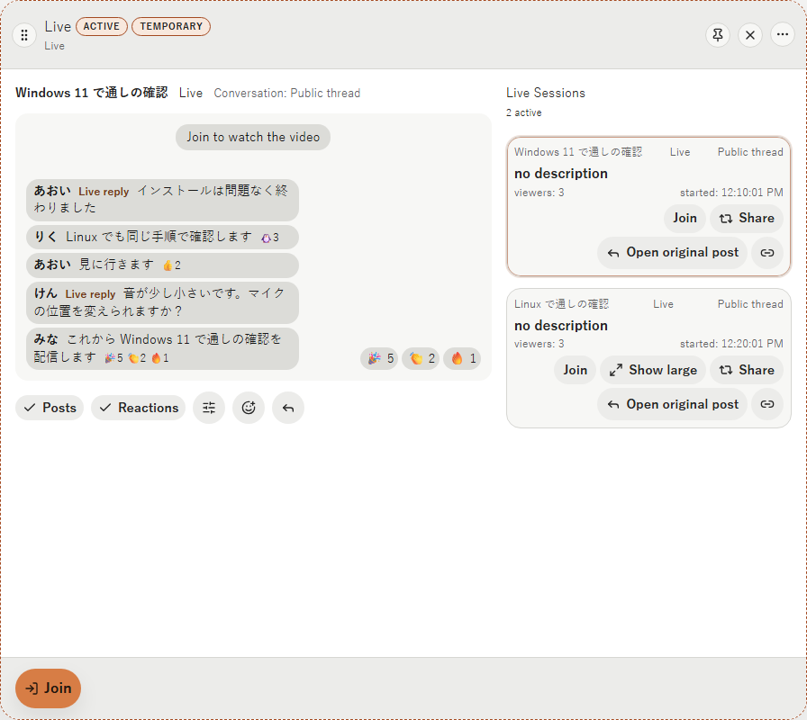
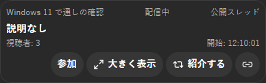
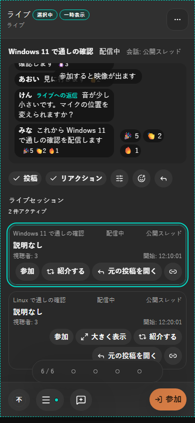

# 2026-10-18 ライブの列の左側に Live を大きく出す入口

- Status: current
- Supersedes: None
- Superseded by: None
- PR: #1841 AC-3 の PR（Refs #1841）
- Preview: 下の「画面」
- Surface / user / purpose: ライブの列（幅 2）の左側と、Live の一覧のカード・投稿の中の Live の「大きく表示」。Live を見ている利用者が、選んだ Live を大きく出して会話の投稿とリアクションを重ねて見て、別の Live へ切り替える。重ねる部品そのものの見た目は [AC-2 の record](2026-10-18-1841-live-stage.md) のとおり。
- Summary:
  - ライブの列が Live を示している（列の entity がある）間、左側（今までは一覧の見出しと件数だけ）に、その Live を大きく出して重ねる部品を置く（2026-10-18 のユーザー判断 1）。一覧の見出しと件数は右側の一覧の上へ移す。右側の一覧はそのまま。
  - 入口（判断 6、D1）:
    - 公開スレッドの詳細の上部の配信の行（既存）。その Live を示すライブの列が開き、左側に出る。
    - ライブの列の一覧のカードの「大きく表示」。押すと列を置き換えて、左側の Live を切り替える（列は 1 つのまま）。左側に出している Live のカードには出さず、そのカードの映像も出さない（同じ Live の映像は左側に出ている）。
    - 投稿の中の Live（開始 post・紹介 post）の「大きく表示」。その投稿の場所を会話にしたライブの列を開く。Live の場所が投稿の場所と違えば列に持たせ、workspace の保存と URL に載せる。
  - 会話の名前は「会話: 〈スレッドのタイトル・channel の名前・topic〉」。スレッドのタイトルを手元に持たないときは「公開スレッド」と出す（列の見出しと同じ扱い）。
  - 「ライブへの返信」の印は、左側に出している Live の開始 post への返信だけに付く（Live を切り替えると付く投稿も変わる）。
  - 本文も添付も無い投稿（本文を空にした開始 post・単純な repost）は重ねず、最新 5 件はそれ以外の投稿から数える（2026-10-18 のユーザー判断。AC-2 の監査の指摘の「名前 添付 0 件」と出る表示を直した）。
  - 「大きく表示」と左側の表示は、Live の画面と同じく開発者モードでだけ出す。Web では出さない。
- Conditions:
  - Platform: ブラウザ mock（Chromium の Playwright）。映像と音声は、Windows・Linux の実アプリの試験 LV-13（CI）で確かめる。
  - Viewport: 1440×900、390×844
  - Theme: dark、light
  - Locale: ja、en（zh-CN は文言だけ。i18n の一致の試験で鍵を確かめた）
  - State: 公開スレッドの「ライブ」の列（Live 2 件、ほかの人の配信）で、一覧 → カードの「大きく表示」→ 別のカードで切り替え。スレッドの詳細の投稿の中の Live の「大きく表示」。狭い幅の左側の表示。
- Accessibility / interaction（Playwright と Vitest で確かめた）:
  - 「大きく表示」は名前のある button（icon と文言）。カードの操作の並びの中に置き、keyboard で届く。
  - Live を切り替えても列は 1 つのまま（`column:stream` の列が 1 つ）。前の Live の開始 post への新着は浮かべない（Vitest）。
  - 投稿の中の Live から開くと、URL はスレッドの scope と Live の id を持つ（`channel=…&sessionId=…`）。紹介 post から開いた Live の場所は `liveTopic`・`liveChannel`（Vitest）。
  - 1440px・390px のどちらでも横に溢れない。狭い幅では左側の表示が上、一覧が下になる（`.shell-stream-layout` の 1 列）。
- Performance: 左側の会話の場所は、表示中の間だけ既存の 3 秒の読み直しに足す（参加していない private channel は足さない）。投稿は通常の一覧と同じ上限（8 つの一覧・200 行）の中で持ち、列を閉じると外す。Live の場所が違えば、その場所の購読の需要を列に結び付けて取り、列を閉じると外す（observer は列の id に `#live`）。同じ Live の視聴は、左側と投稿の中で 1 つを共有する（LV-13）。
- Validation:
  - Vitest: `DesktopShellPage.liveStage.test.tsx`（カードの「大きく表示」で左側に出し、別のカードで列を置き換えて切り替え、前の Live の新着は浮かべず数は新しい Live の開始 post のもの。紹介 post の「大きく表示」でスレッドを会話にした列を開き、Live の場所を保存と URL に載せ、Live の場所の購読の需要を取り、列の下部から参加し、閉じると需要を外す）、`store.test.ts`（左側の会話の投稿の保持と、閉じたときの解放）、`workspacePersistence.test.ts`・`routes.unit.test.ts`（Live の場所の往復）、既存の Live・route・shell の試験。
  - 実アプリ: `live.mjs` の LV-13（Windows・Linux、CI）。
  - Playwright（ブラウザ mock を開く単体の script）: 上の撮影と 8 項目の確認（すべて成功）。
- Not verified: zh-CN の画面の撮影（文言だけ確かめた）。実機の映像・音声は LV-13 の CI の結果で確かめる。
- Review result: ja・dark と en・light、狭い幅で確認した。最初は、Live を切り替えた直後に重ねる投稿が 2 秒ほど消えた（列が変わると、左側の会話の投稿が表示中の一覧の保持の対象から外れていた）。左側の会話の場所を保持の対象に入れる形に直した。
- Exceptions: None

## 画面

公開スレッドの「ライブ」の列の一覧（ja・dark。カードの「大きく表示」）:

カードの「大きく表示」で左側に出した列（ja・dark）と、別のカードで切り替えた列:

en・light:

投稿の中の Live の「大きく表示」（ja・dark）:

狭い幅（ja・dark、390×844）:

