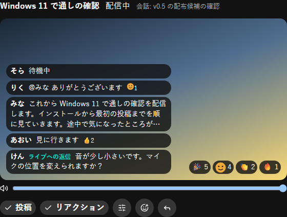
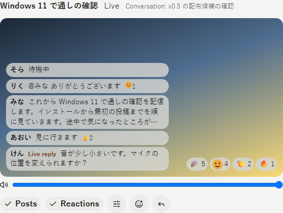
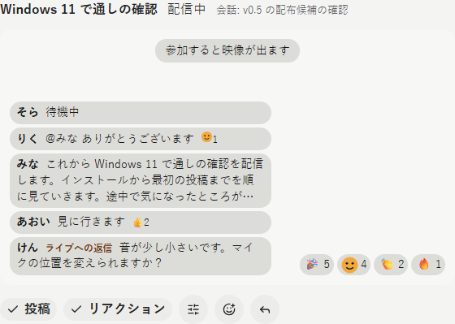
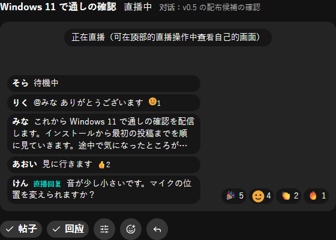
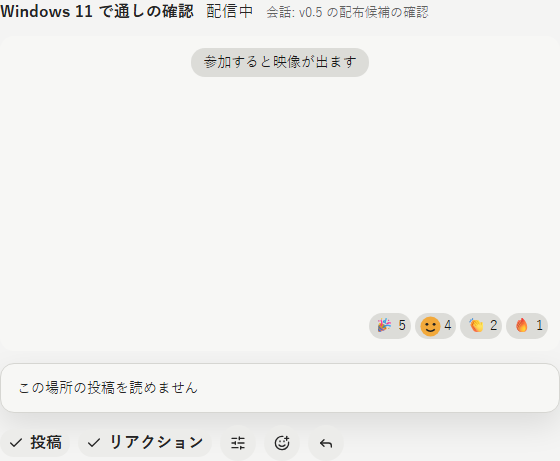
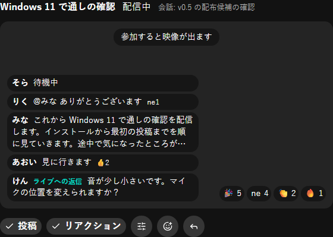
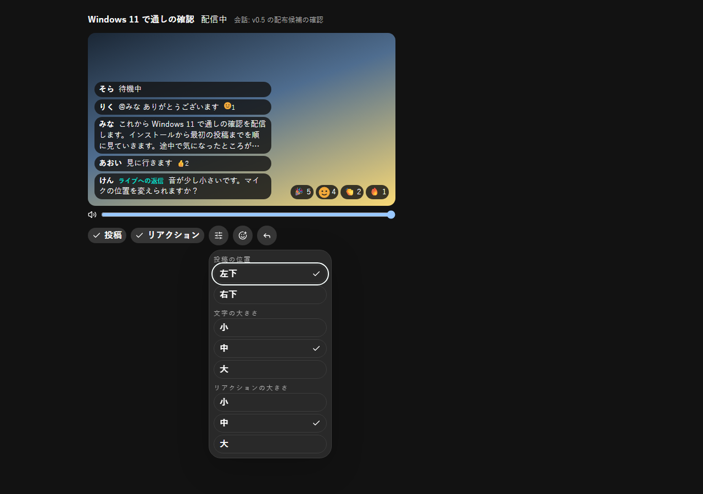
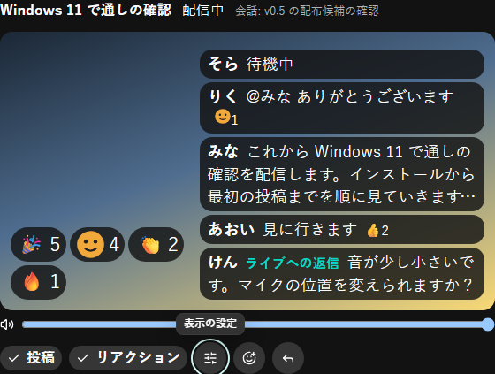
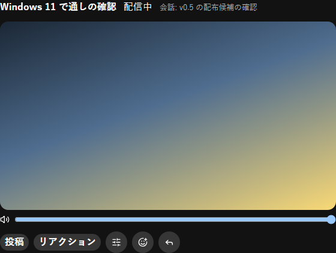
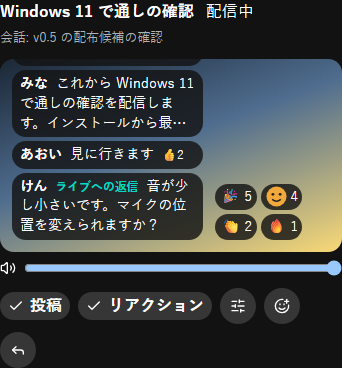

# 2026-10-18 Live に会話の投稿とリアクションを重ねる表示

- Status: current
- Supersedes: None
- Superseded by: None
- PR: #1841 AC-2 の PR（Refs #1841）
- Preview: 下の「画面」
- Surface / user / purpose: ライブの列（幅 2）の左側に置く、選んだ Live を大きく出す部品（`LiveStage`）。Live を見ている利用者が、映像を見ながら会話の場所の投稿と開始 post のリアクションを同じ画面で読み、開始 post に返信・リアクションする。列への組み込みと入口は AC-3 で行う。
- Summary:
  - 映像の上に、会話の場所の最新 5 件の投稿と、開始 post のリアクションを重ねる（2026-10-18 のユーザー判断 1〜3）。投稿は古い順に積み、新しい投稿を下に足す。開いた後に届いた投稿だけを短い fade で出す。
  - 投稿は 1 件 3 行までで、付いたリアクションを多い順に 3 種まで添える。開始 post への返信には「ライブへの返信」の印を付ける（判断 4）。
  - 開始 post のリアクションは、投稿と反対側の下に多い順に 8 種まで数と出し、新しく届いたものを 1 件ずつ上へ浮かべて 3 秒で消す（同時に 12 個まで）。
  - 層の切替（投稿・リアクション）と表示の設定（投稿の位置: 左下・右下、文字の大きさとリアクションの大きさ: 小・中・大）を映像の下に置く。設定は端末に 1 組だけ保存する（判断 5）。両方の層を切ると映像だけになる。
  - 「ライブにリアクション」と「ライブに返信」は開始 post に付ける（既存の picker と返信の入力）。層の切替・設定の変更では何も送らない。
  - 状態: 視聴中、参加前（「参加すると映像が出ます」）、配信者本人（「配信中です（自分の映像は上部の配信の操作で確かめられます）」）、終了（「このライブは終了しました」だけ）、会話の場所を読めない（「この場所の投稿を読めません」を出し、投稿を重ねない）、投稿なし（何も重ねない）、custom reaction の画像が無い（名前の先頭 2 文字）。映像の代わりの案内と視聴の状態（接続中など）は、映像の上の中央に重ねた投稿より手前に出す。
  - 重ねた層は読み上げず、pointer を受けない。列が見えない間と reduced motion では浮かべない。
- Conditions:
  - Platform: Storybook（Chromium の Playwright）。映像は代わりの背景（暗い所と明るい所を含む gradient）で、映像の bytes は送らない。実機の映像・音声は AC-3 の Windows・Linux の実アプリの試験で確かめる。
  - Viewport: 1280×900（部品の幅 560px）、390×844
  - Theme: dark、light
  - Locale: ja、en、zh-CN
  - State: `Shell/LiveStage` の `Watching`・`FloatingReactions`・`BeforeJoining`・`Broadcaster`・`MissingImage`・`NoPosts`・`Unreadable`・`Ended`。設定の menu・右下と大きい文字・層を切った状態は、`Watching` で操作して撮った。
- Accessibility / interaction（Playwright で確かめた）:
  - keyboard: 音量の次に「投稿」「リアクション」「表示の設定」「ライブにリアクション」「ライブに返信」の順に届く。層の切替は `aria-pressed`、設定の menu は既存の menu と同じく上下の key で項目を移り、選択中の項目は `menuitemradio` の `aria-checked` と印で示す。focus の輪が見える。
  - 重ねた投稿の上を押すと、その下の映像（canvas）に届く（`elementFromPoint`）。操作のボタンは映像の範囲に重ならない。
  - 重ねた層は `aria-hidden`。読み上げの live region は置かない（大量の更新を読み上げない）。同じ内容と操作には、スレッドの列から届く。
  - 390px の幅で横に溢れない。狭いと古い投稿が上から切れる（新しい投稿を下に足し、古いものは上から消える。判断 2）。
  - reduced motion では浮かべず（0 個）、投稿の fade も既存の動きの token で 1ms になる。
- Performance: 投稿は通常の列と共用する cache の最新 5 件だけを描く。浮かべるのは同時に 12 個まで（待ち 24、1 個 3 秒）。重ねる層は DOM で、映像の受け取り・復号・描画（#1839 の共有の視聴）は変えない。同じ Live の重ねない表示（投稿の中の Live）と視聴を 1 つ共有し、同じ映像の bytes を受ける（Vitest）。
- Validation:
  - Vitest: `LiveStage.test.tsx`（投稿の重ね・新着の印・custom reaction の画像と代わりの表示・層を切ると映像だけ・設定の保存と表示の操作で何も送らない・リアクションと返信の入力先が開始 post・同じ新着を再描画や重ねての知らせで重ねて浮かべない・終了／配信者本人／読めない会話の状態・重ねた表示の下の映像が重ねない表示と同じで視聴を共有する）。既存の `PostLive`・`LiveSessionMedia`・`PostCard`・CSS の契約の試験。
  - Storybook: `Shell/LiveStage`。
  - Playwright（Storybook を開く単体の script）: 上の撮影と、浮かべる数・reduced motion・pointer・読み上げ・操作の重なり・keyboard の順・設定の反映と保存・層を切った表示の確認（11 項目すべて成功）。
- Not verified: 実機（Tauri の WebView2・WebKitGTK）の映像の上の見え方と音声。AC-3 で列に組み込んでから、実アプリの試験で確かめる。
- Review result: ja・dark を中心に、en・light、zh-CN・dark、狭い幅で確認した。最初は映像の代わりの案内を映像の中央に置いたため、重ねた投稿に隠れて読めなかった。案内は上の中央に置き、重ねた投稿より手前に描く形に直した。3 行で切った投稿の次の行が下の余白に少し見えたので、上下の余白を border で取る形に直した。
- Exceptions: None

## 画面

視聴中（ja・dark。映像は代わりの背景）:

en・light:

新しく届いたリアクションを浮かべる（ja・dark）:

参加前（ja・light）と配信者本人（zh-CN・dark）:

会話の場所を読めない（ja・light）と custom reaction の画像が無い（ja・dark）:

表示の設定の menu と、右下・大きい文字・大きいリアクションにした表示（ja・dark）:

層を両方切った表示（ja・dark）:

狭い幅（ja・dark、390×844）:

