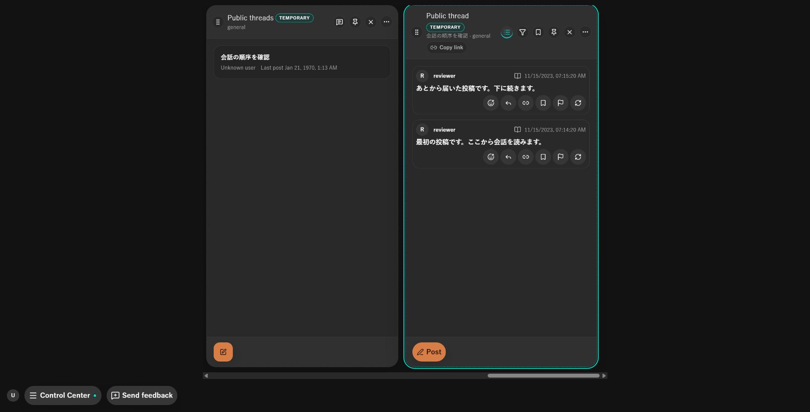
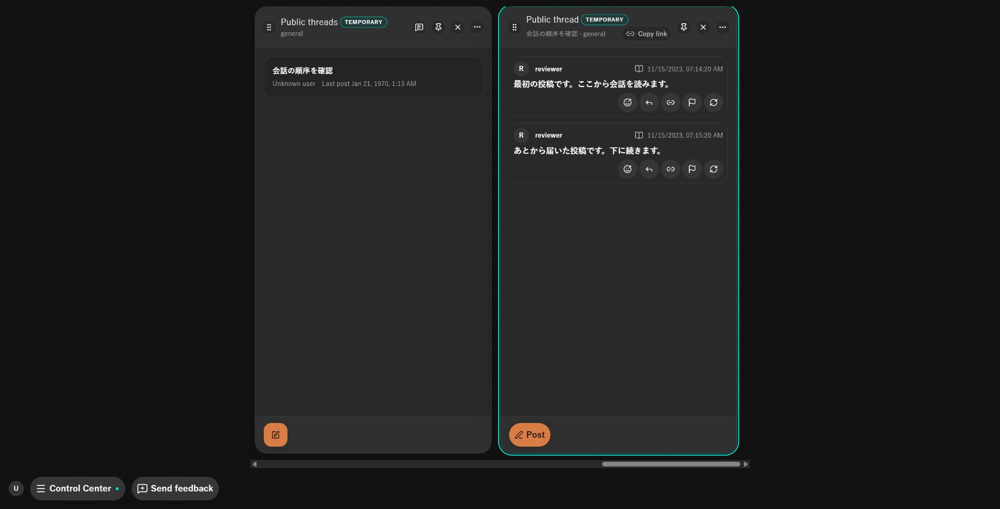
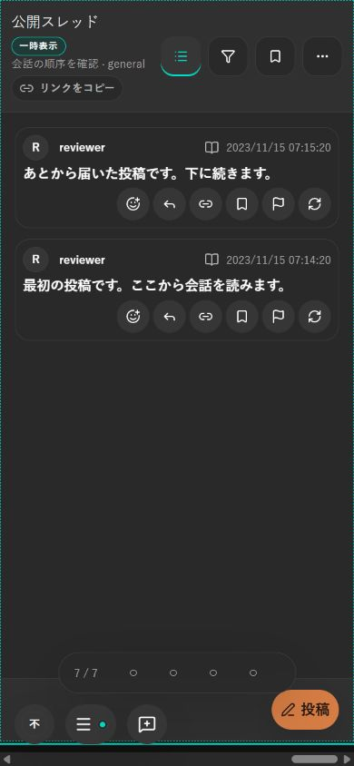
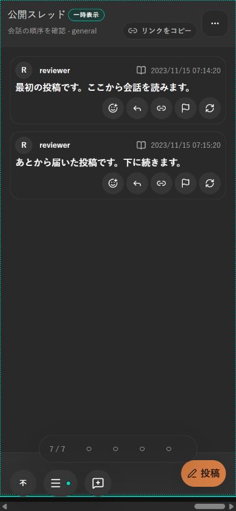

# 公開スレッド詳細の会話順

- Status: current
- Supersedes: None
- Superseded by: None
- Issue: #1887
- 対象: 公開スレッドを読む人が、古い投稿から会話を追えること。タイムライン用のフィルターとブックマーク操作を切り分ける。
- 条件: Chrome、dark、通常幅1858×947・英語、390×844・日本語。固定した二つの投稿を同じStorybook fixtureで比較。

| 条件 | 変更前 | 変更後 |
| --- | --- | --- |
| 通常幅 |  |  |
| 狭幅 |  |  |

公開スレッドの先頭が古い投稿となり、詳細のフィルター・ブックマーク表示切替・投稿のブックマーク操作はない。通常タイムラインには従来の操作が残る。pointerで返信を開き、入力後Ctrl+Enterで同じスレッドへ送信した。リンクのコピー先にも元のtopicとchannelが残る。取得窓の上限とcursorは既存処理を使い、総投稿数に比例する取得・整列は追加していない。

[関連92試験と型・lint・buildの記録](../progress/2026-10-19-1887-public-thread-column.md)を参照。狭幅のviewport値もDOMで390×844と照合した。色・token・CSS・ネイティブ連携は変更していないため、contrast再測定とTauriでの重複操作は行っていない。screen reader・実touch・実機High Contrastは未確認。変更した操作経路はsemantic buttonと既存のkeyboard操作を維持する。独立検品とPR CIは別途記録する。
