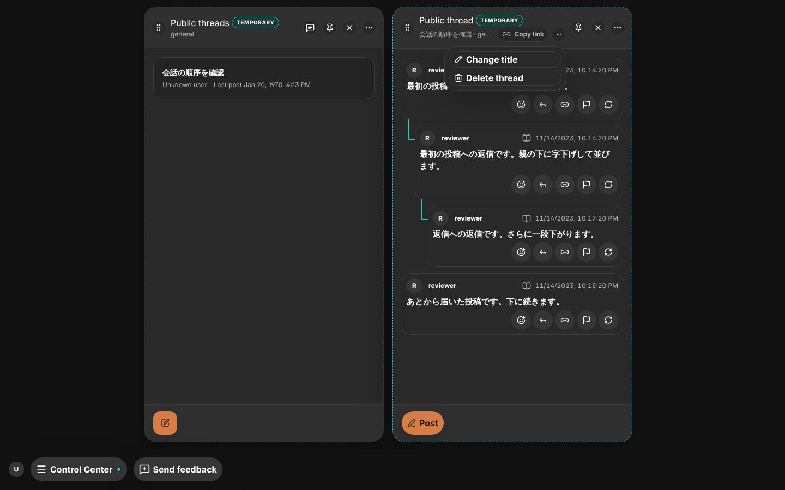
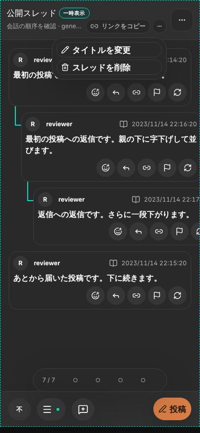
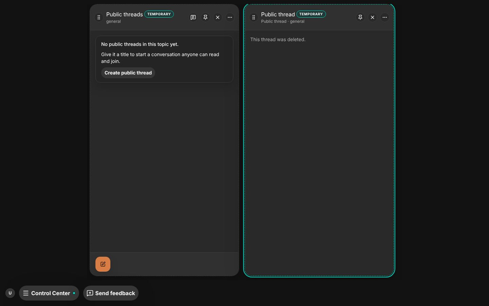
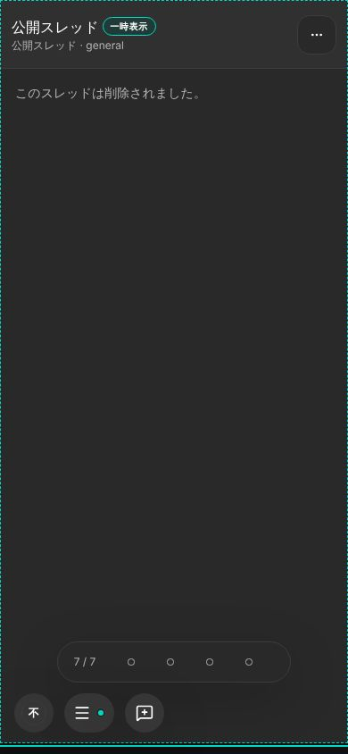
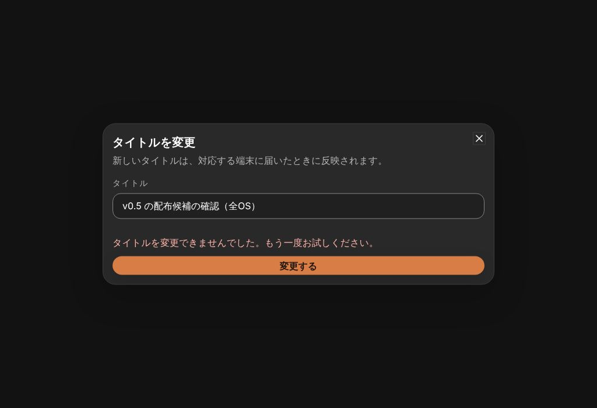
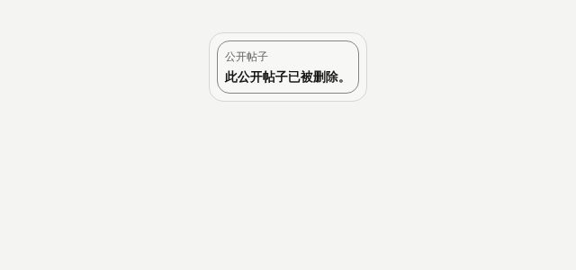

# 公開スレッドのタイトルの変更と削除

- Status: current
- Supersedes: None
- Superseded by: None
- Issue: #1888（AC-2）
- 対象: 公開スレッドの作成者が、詳細の列からタイトルを変え、スレッドを削除する。読む人は、削除されたスレッドを一覧・詳細・本文のリンクで削除済みとして見る。
- 条件: Chrome（Storybook の `Shell/PublicThreadDetail` の `Own`・`Deleted`、`Shell/PublicThreads` の `RenameDialog`・`CardDeleted`）、dark（card だけ light）、通常幅 1440×900・英語、390×844・日本語、card は簡体字中国語。

| 状態 | 通常幅 | 狭幅 |
| --- | --- | --- |
| 作成者の menu |  |  |
| 削除したスレッドの詳細 |  |  |

| タイトルの変更の Dialog（変更に失敗した表示） | 削除したスレッドの card |
| --- | --- |
|  |  |

作成者にだけ、上部の「リンクをコピー」の後ろに icon の menu を置き、「タイトルを変更」と「スレッドを削除」を出す。変更の Dialog は作成と同じタイトルの欄で、変わらないタイトルと空のタイトルでは送れない。削除は `window.confirm` で確かめ、断れば何もしない（投稿の取り下げと同じ確認）。削除されたスレッドの詳細は、上部の操作・配信の行・投稿・投稿欄を出さず、本文の位置に削除されたことだけを出す。狭幅でも menu は scope の行に収まり、項目は既存の並び順の menu と同じ形。

menu・Dialog・削除の確認は既存の semantic button・Dialog・Popover の部品で、keyboard の操作は既存の部品のまま。読み上げの名前は「Manage thread／スレッドの管理」。色・token・CSS は変えていないので、contrast は再測定していない。表示中の詳細は同期の時刻が変わったときに 1 件だけ ID から読み直し、件数に比例する取得は足していない。

検証: Vitest（`PublicThreadRevisions.test.tsx` の 2 件、`DesktopShellPage.publicThreads.test.tsx` の削除済みの詳細、frontend の全 302 ファイル）、`pnpm typecheck`、`pnpm lint`。未確認: screen reader、実 touch、Tauri の実機、High Contrast。
