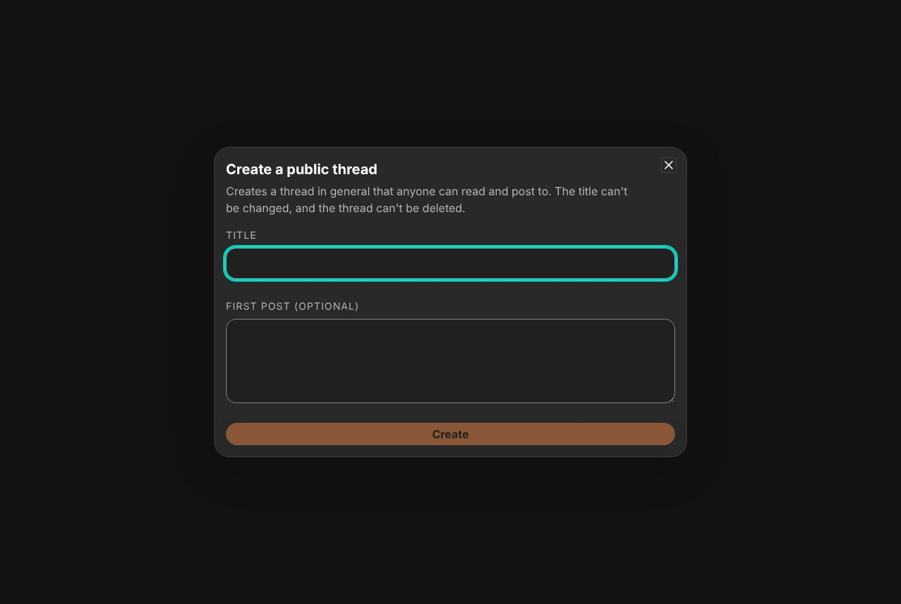
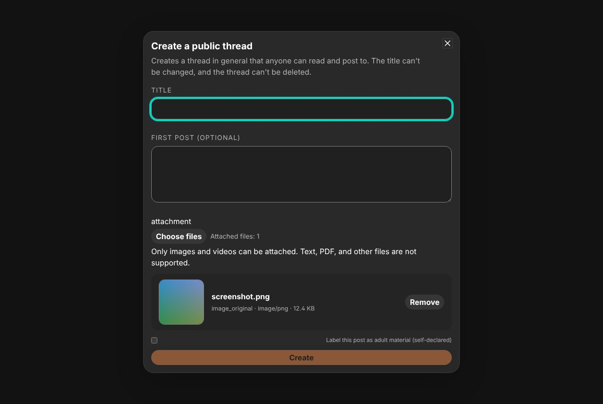
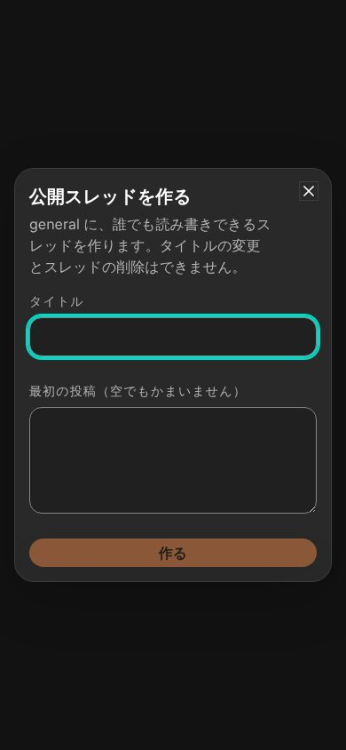
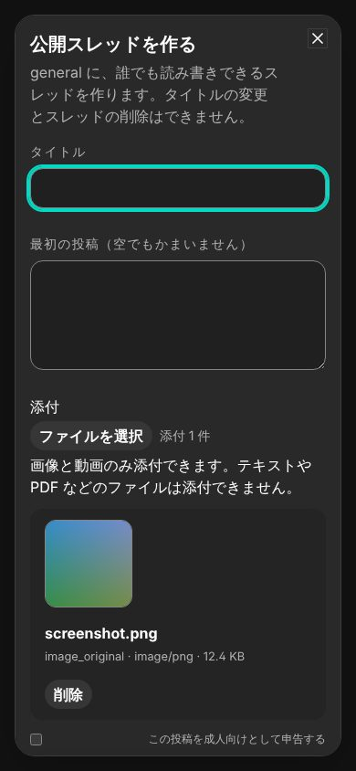

# 公開スレッド作成時の添付と成人向けの自己申告

- Status: current
- Supersedes: None
- Superseded by: None
- Issue: #1889
- 対象: 公開スレッドを作る人が、最初の投稿にタイムラインの投稿と同じ添付と成人向けの自己申告を付けられること。
- 条件: Chrome、dark、Storybook `Shell/PublicThreads` の `CreateDialog`。1280×860・英語、390×844・日本語。変更後は画像を1件選んだ状態。

| 条件 | 変更前 | 変更後 |
| --- | --- | --- |
| 通常幅 |  |  |
| 狭幅 |  |  |

添付欄（選択ボタン・件数・対応形式）・プレビューの一覧・成人向けの切替は、タイムラインの composer と同じ部品を使う。本文の欄への画像の貼り付けも同じ扱いにした。狭幅では Dialog の内容が縦に scroll し、作成ボタンへ届く（DOMで確認）。token・色・CSSは変更していないため、contrast の再測定は行っていない。選択・取り外し・貼り付け・成人向けの切替・作成は Vitest（`DesktopShellPage.publicThreads.test.tsx`）で確認した。screen reader・実touch・Tauri 実機は未確認。
