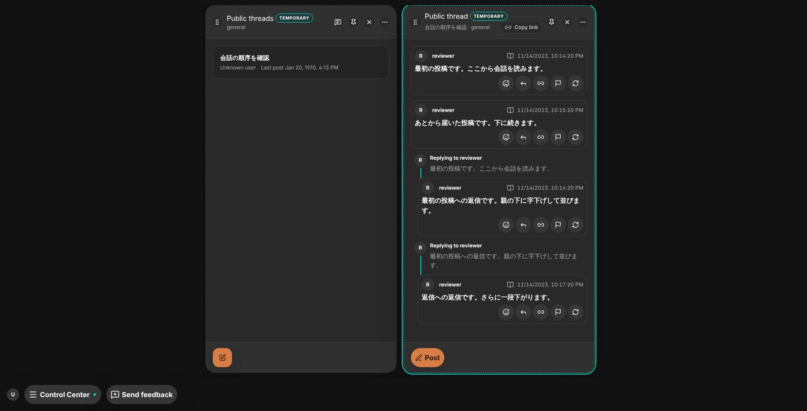
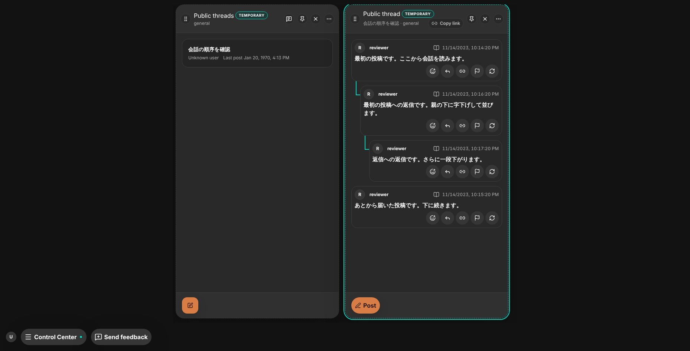
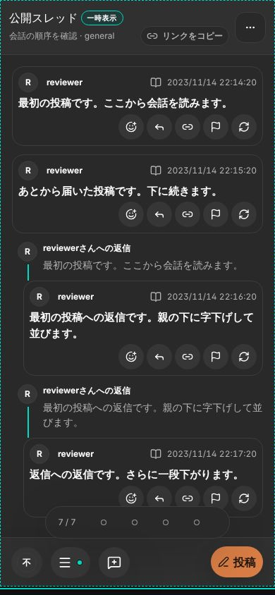
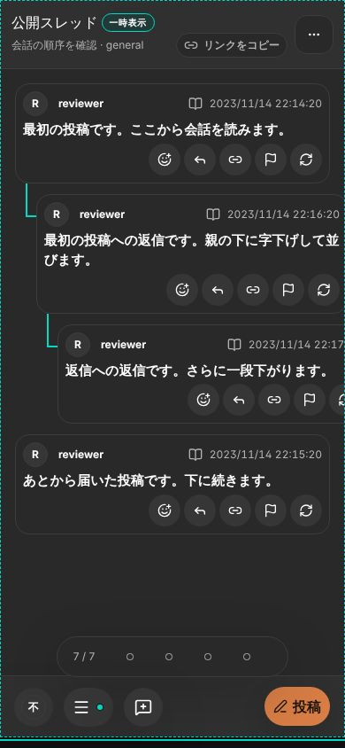
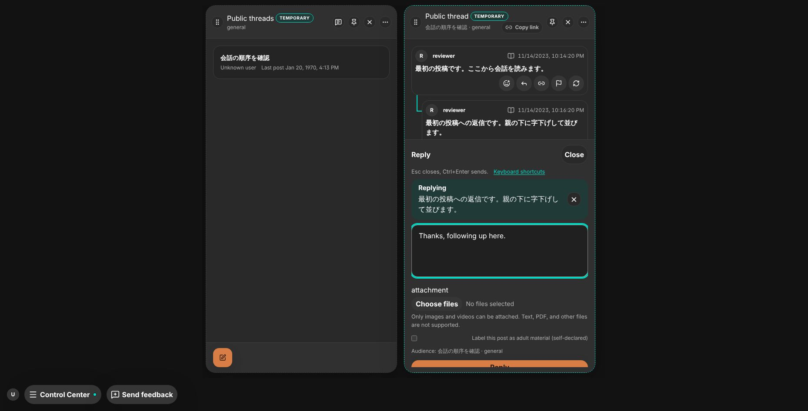

# 公開スレッド詳細の返信ツリー

- Status: current
- Supersedes: None
- Superseded by: None
- Issue: #1891
- 対象: 公開スレッドを読む人が、詳細の列の中で会話をツリーで追い、返信まで終えられること。返信の列へ分岐させない。
- 条件: Chrome（Playwright 1.63 の Chromium）、dark、通常幅1858×947・英語、390×844・日本語。同じStorybook fixture（`Shell/PublicThreadDetail`、最上位2件・返信・返信への返信）で比較。

| 条件 | 変更前 | 変更後 |
| --- | --- | --- |
| 通常幅 |  |  |
| 狭幅 |  |  |

変更前は返信が「返信先」の簡略表示つきで平らに並び、「返信」と本文の押下が右に返信の列を開いた。変更後は返信が親の下に返信の列と同じ字下げ・接続線で並び、ツリーの中の返信には簡略表示を出さない。狭幅の深い返信は、返信の列と同じくカードの下限幅を保って列の本文を横スクロールする。

返信: 通常幅で返信への「返信」をpointerで押すと、同じ列の下部の入力欄が「返信」として返信先つきで開き（）、Ctrl+Enterで送ると返信が親の下（深さ2）に入った。列の並びは変わらず、返信の列は開かない。

取得窓の上限・cursor・ページ取得は変えず、ツリーは表示中の有界な窓だけで組む。色・token・CSSは変更していないため、contrastの再測定は行っていない。screen reader・実touch・Tauri実機は未確認。本文は押せる要素（role=button）から、押しても何も開かないgroupに変わる。keyboardの「返信」・Esc・Ctrl+Enterは既存の入力欄の操作を使う。
