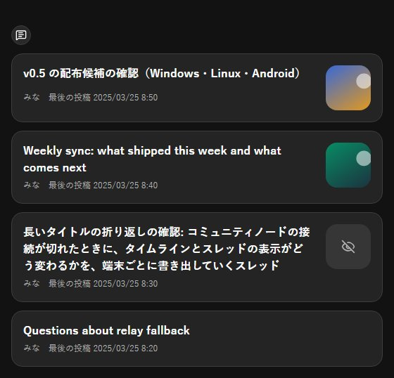
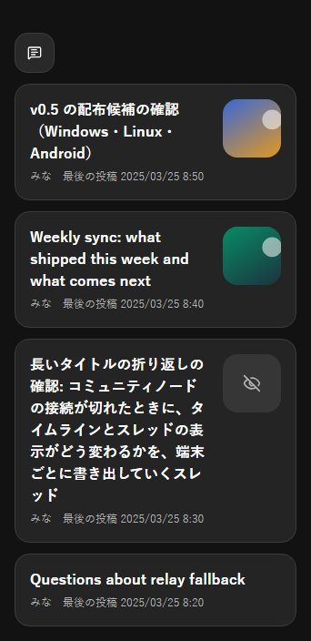
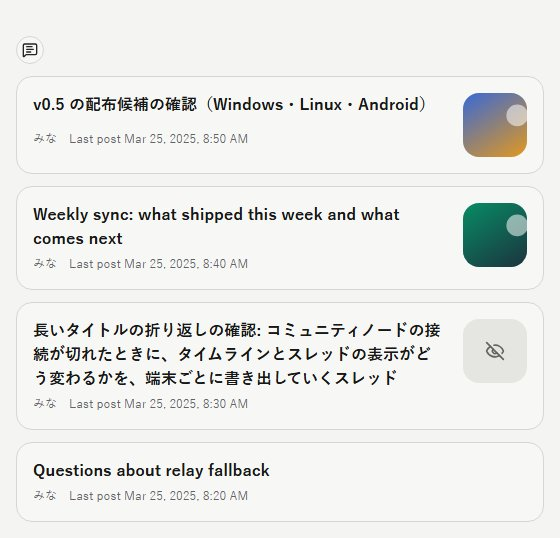
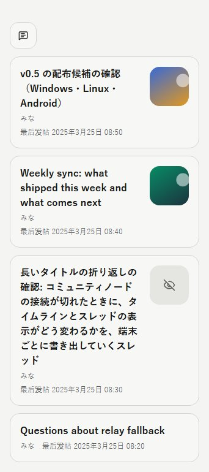

# 公開スレッド一覧のサムネイル

- Status: current
- Supersedes: None
- Superseded by: None
- Issue: #1900
- 対象: 公開スレッド一覧の行に、最初の投稿の 1 枚目の画像をサムネイルとして出し、どのスレッドか見分けやすくする。
- 条件: Chrome、Storybook `Shell/PublicThreads` の `ListThumbnails`。通常幅 1440×900（日本語・dark、英語・light）、390×844（日本語・dark、簡体字中国語・light）。

| 通常幅 | 狭幅 |
| --- | --- |
|  |  |
|  |  |

行は上から、画像つきの最初の投稿、動画だけの最初の投稿（静止画を出す）、成人向けと申告した最初の投稿（表示設定 OFF。伏せた印）、最初の投稿に添付の無いスレッド。

2026-10-21 のユーザー判断に従い、サムネイルは行の右に 64px の正方形で出し、画像の無い行は場所を空けずに今の見た目のままにした。成人向けとして伏せる画像（本人の申告・Community Node の判定・同じ画像が別の投稿で伏せられている）は、投稿 card と同じ判定で伏せた印を出し、画像を取得しない。画像は投稿 card と同じく、画面に出ている間だけ取得する。

サムネイルは行の button の中にあり、操作は今と同じく行を押すと詳細を開く。画像は飾りとして読み上げに含めず（`alt=""`）、伏せた印だけが「成人向けとして伏せた画像」と読み上げられる。狭幅でも横の scroll は起きない（DOM で確認）。色は既存の token（`--surface-skeleton`・`--muted-foreground`）を使い、新しい token は足していない。

一覧の取得は、手元にある最初の投稿だけを行に付ける（ページの行の分だけ読む）。手元に無い行は、画面に出たときに ID からの取得で読み、一覧の表示は待たせない。

検証: Vitest（`PublicThreadList.test.tsx`、`DesktopShellPage.publicThreads.test.tsx`）、app-api の `list_rows_carry_the_first_post_once_it_is_local`。未確認: screen reader、実 touch、Tauri の実機、High Contrast。
