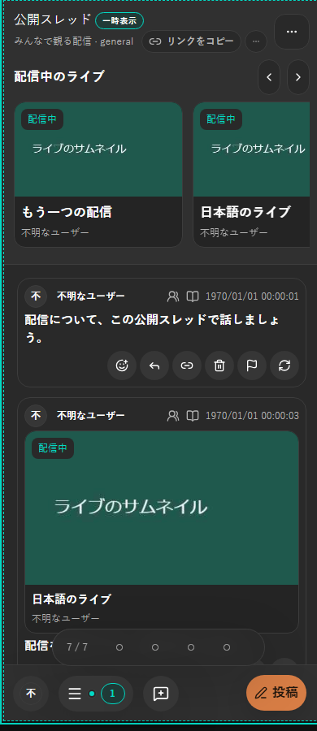
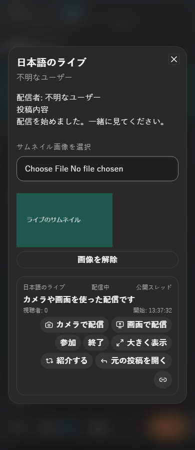
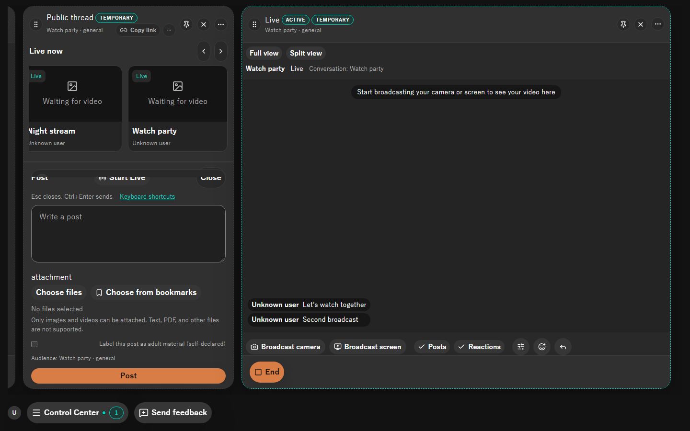
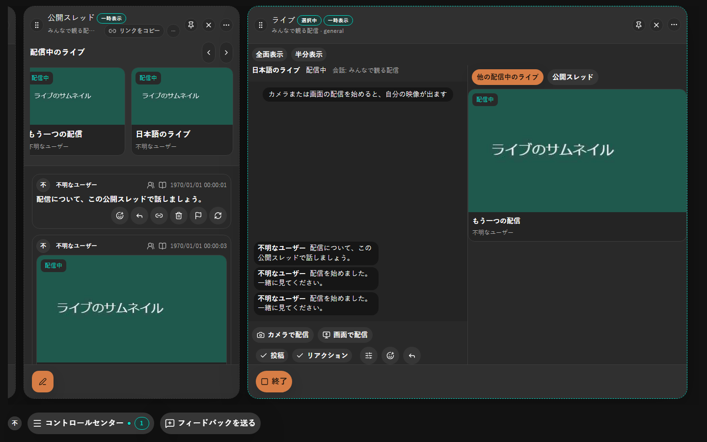
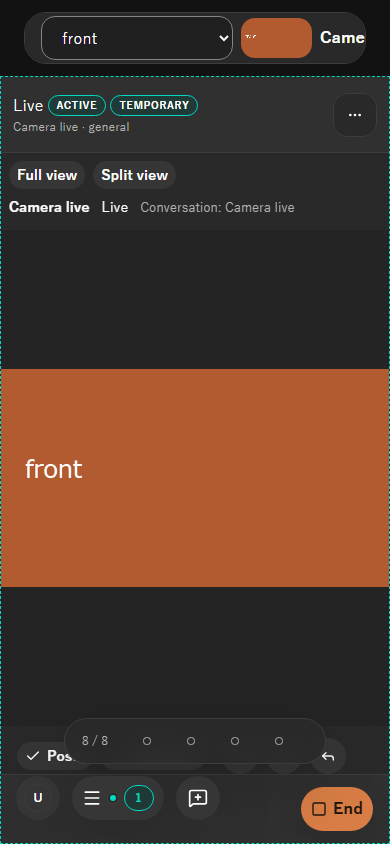

# 2026-10-25 ライブの開始・一覧・拡大表示

- Status: current
- Supersedes: [公開スレッドの配信一覧と開始導線](2026-10-18-1840-public-thread-lives.md)、[ライブカラムの配置](2026-10-18-1841-live-stage-column.md)
- Superseded by: None
- PR / identifier: `codex/live-entry-layout`、Scope revision 2
- Surface / user / purpose: 投稿者・配信者・視聴者が、会話の場所からライブを始め、画像から内容を確認して参加し、選んだ配信を大きく見る。
- Summary: 開始を公開スレッド作成と投稿フォームへ移した。ヘッダー直下のカルーセルと他の配信一覧はサムネイル主体のカードを共用し、詳細モーダルから参加する。個別ライブは全面表示を初期値とし、半分表示の補助領域を他の配信中ライブと公開スレッドで切り替える。本人映像とカメラ選択にも対応した。
- Conditions: Windows上のChromium、1440×900・390×844（日本語の狭幅は390×900）、dark、日本語・英語。未参加、配信中、本人映像、手動画像、画像解除、自動更新、終了済みの除外、manifest取得待ち、成人向け投稿の代替表示を対象とした。
- Accessibility / interaction: 実pointerで作成・画像選択・詳細・参加・表示切替を操作した。切替タブは左右矢印・Home・Endに対応し、フォーカスも移す。カルーセルには前後の44pxボタンを置き、横スクロールとスナップを使う。画面全体の横overflowがないことと、モバイルのカメラ選択が画面内にあることを確認した。
- Performance: 既存の有界な一覧・投稿cacheを使う。画像は表示中のカードだけが取得し、配信の静止画は30秒間隔・同時1要求で更新する。固定keyを置き換え、投稿・manifest・blobを更新ごとに増やさない。署名・画像形式・寸法と容量を受信側でも確認する。
- Validation: 受入条件とコマンド・結果は[作業記録](../progress/2026-10-25-live-entry-layout.md#検証記録)を参照。
- Not verified: Android実機の複数カメラ、Tauri WebView、screen reader、WebAssemblyの追加ビルド（ローカルに`clang`が無いため停止）。Chromiumでは2つの仮想カメラを実際のMediaStreamにして確認した。
- Review result: PASS。対象の描画・操作と、`3c8d8f832`の固定headの独立監査を完了。成人向け表示制限、限定channelの遠隔取得、本人の操作がサムネイル照会を待たないことを確認し、blockerは0件。詳細は作業記録を参照。
- Exceptions: 変更前の画像は過去の同対象recordを参照する。今回と完全に同じfixtureの変更前スクリーンショットは取得していない。本人映像の欠落は基準commitに対する失敗testで再現した。

## 画面

